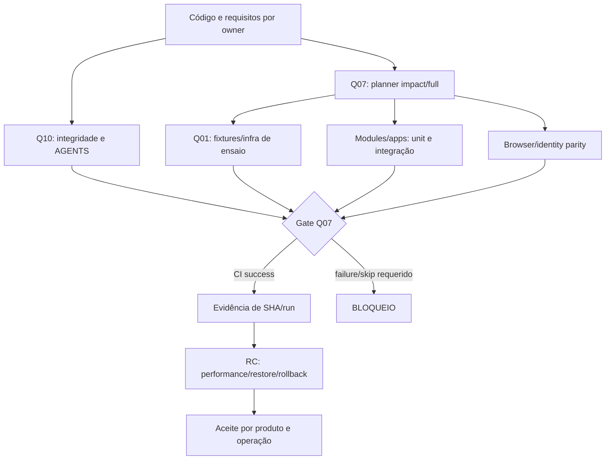

[← Ficha do capítulo](../) · [Volume](../../) · [Fonte original](https://github.com/delmacy/syndes-system/blob/main/docs/subprojects/Q01-plataforma-de-testes/chapters/05-arquitetura-banco-interface-configuracao-e-diagramas.md)

> Conteúdo espelhado da documentação versionada; não expressa automaticamente estado funcional.

## 5. Arquitetura de testes, interfaces, dados e fluxos

### Topologia lógica de prova (não topologia de produção)

**Interpretação:** Q01 dá organização às provas; não inventa um test runner central de runtime. GitHub Actions executa Q07; Q10 e módulos possuem seus próprios checks. RC e aceites são processos distintos, não jobs automaticamente disparados por esse desenho.

### Mapa de ambientes

| Ambiente | Propósito | Dados e isolamento | O que não se pode concluir |
|---|---|---|---|
| Unit local | Testar regra e validação | Mocks, fixtures sintéticas e módulos isolados | Segurança de banco real |
| Teste PG17 descartável | Persistência/roles/tenant, Serviço e migrations | Container efêmero, portas restritas/labels, cleanup | Migration de produção aplicada |
| Integração de identidade | Keycloak, OpenFGA, OpenBao, JWT/Host | Containers CI, realms/stores e secrets de fixture | Grants, tokens e DNS da operação |
| Browser de CI | Workspace/Manager/Support conforme jobs | App/browser de ensaio e personas de teste | Homologação por usuário real |
| Performance | Stress/spike/soak **previstos** | RAM/CPU controladas, provedores mock/real separados | Capacidade provada em 2500 tenants |
| Staging/produção | Rollout, restore, smoke e suporte real | Acesso, backups e identidades operacionais | **Não auditados nesta unidade** |

### Fronteiras de dados e fluxo

`Control Plane` mantém registry, roles e escopo global; cada `tenant database` é isolado. Os testes de PostgreSQL exercitam proibição de conexões indevidas e provisionamento de fixture, mas não criam dados permanentes da Q01. Os testes de OpenFGA validam grants simulados de A/B; os de Keycloak usam identidades descartáveis. **Q01 não cria database, tabela nem migration próprias.**

### Configurações e riscos

- `infra/.env.ci` é fonte de variáveis **de teste**; não usar esse arquivo como modelo de credenciais de produção.
- `tests/platform/core-host-runtime-smoke.sh` verifica `GITHUB_ACTIONS=true` e `CI_RUNTIME_SMOKE=1` para recusar execução fora de CI.
- `tests/platform/ci-secret-fixtures.py` escreve arquivos sob `/run/syndes/runtime`; não executar sem contexto isolado, volume descartável e autorização.
- `run-infra.sh` instala/derruba containers e redes CI e faz cleanup; rodar diretamente no DevServer compartilhado pode interferir com redes existentes. **Esta auditoria não o executou localmente.**
- A suite de serviço `service-management` usa PG17 descartável e o CI Q07 a executou com sucesso no SHA da baseline. Isso não ativa o plugin no Host operacional.
- Não há API ou frontend da Q01; as telas do portal servem para consultar evidência, não controlar infraestrutura ou alterar permissões.

---
**Rastreabilidade:** [revisar documento fonte](https://github.com/delmacy/syndes-system/blob/main/docs/subprojects/Q01-plataforma-de-testes/chapters/05-arquitetura-banco-interface-configuracao-e-diagramas.md).
