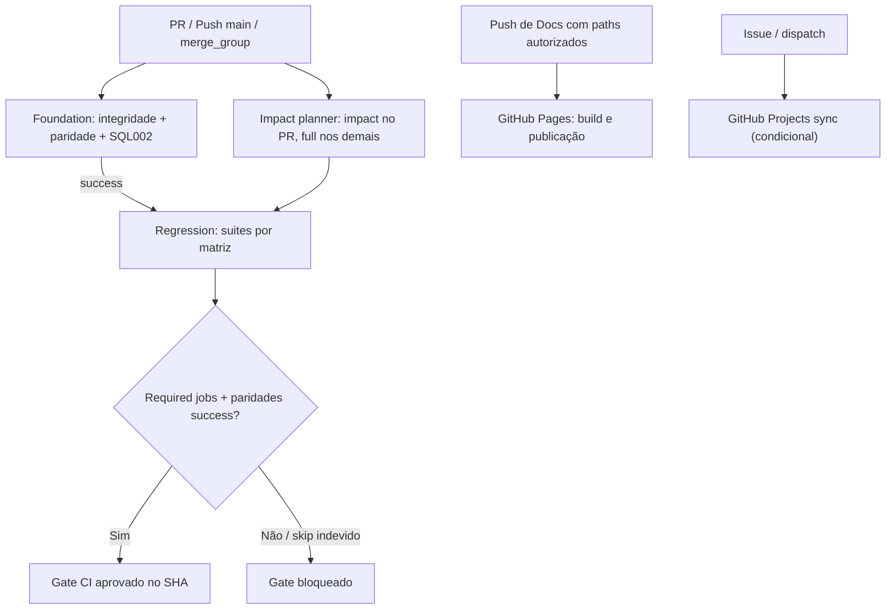

# Q07 — CI/CD

[← Sumário do volume](../) · [↑ Biblioteca](../../)

> **Leitura técnica, não homologação.** Estados, limites e comprovações devem ser lidos em STATUS e nos checkpoints versionados.

## Identificação e rastreabilidade

| Campo | Fonte verificável |
|---|---|
| Unidade / owner | **Q07** · CI/CD |
| Volume | Infraestrutura e qualidade |
| Caminho de implementação | `scripts/ci/plan.mjs` |
| Documento de origem | [README](https://github.com/delmacy/syndes-system/blob/main/docs/subprojects/Q07-ci-cd/README.md) |
| STATUS e critérios | [STATUS original](https://github.com/delmacy/syndes-system/blob/main/docs/subprojects/Q07-ci-cd/STATUS.md) |
| Símbolos, APIs, SQL e dependências | [REFERENCIA-TECNICA](https://github.com/delmacy/syndes-system/blob/main/docs/subprojects/Q07-ci-cd/REFERENCIA-TECNICA.md) |
| Implantação, runbooks e gates | [OPERACAO](https://github.com/delmacy/syndes-system/blob/main/docs/subprojects/Q07-ci-cd/OPERACAO.md) |

## Situação registrada

> AUDITORIA TÉCNICA PARCIAL + CORREÇÃO LOCAL VALIDADA — 12/11/2026. Base origin/main SHA 9521919178bcc0341c4d187492f9d027d188a6bd, DevServer01/worktree isolada. A falha de paridade foi reproduzida e o planner/runner corrigido, com testes locais executados. CI mainline validada no commit ec688ce3b6884ef4d1e6dd10ba4c2f3048dbef0f: 24/24 jobs SUCCESS, inclusive Syndes CI Gate. Isso comprova o pipeline neste SHA, não o Product Gate nem a operação do MVP.…

A descrição acima é uma **citação resumida do STATUS versionado**; não significa que os testes de integração, a implantação ou a homologação estejam aprovados.

## Índice dos subcapítulos

Todos os assuntos deste módulo estão nesta página. Clique em um título para saltar à seção correspondente; o índice lateral acompanha a leitura.

- [Casos de uso](#casos-de-uso)
- [Histórias de usuário](#historias-de-usuario)
- [Requisitos](#requisitos)
- [Contratos públicos e privados](#contratos)
- [APIs e endpoints](#apis)
- [Eventos e mensageria](#eventos)
- [Dados e persistência](#dados)
- [Schemas e migrations](#schema)
- [Dependências e integrações](#dependencias)
- [Configuração e ambiente](#configuracao)
- [Frontend e interfaces](#interface)
- [Testes e evidências](#testes)
- [Operação e implantação](#operacao)
- [WBS e evolução](#wbs)
- [Documentação de origem integral](#documentacao-de-origem)
- [Controle de alterações](#controle-de-alteracoes)

## Casos de uso

**Editar esta seção:** [Abrir arquivo-fonte no GitHub](https://github.com/delmacy/syndes-system/edit/main/docs/subprojects/Q07-ci-cd/chapters/02-requisitos-historias-e-casos-de-uso.md) · [Consultar fonte](https://github.com/delmacy/syndes-system/blob/main/docs/subprojects/Q07-ci-cd/chapters/02-requisitos-historias-e-casos-de-uso.md)

*Referências extraídas da documentação versionada, sem inferir homologação ou implantação.*

**Fonte:** [02-requisitos-historias-e-casos-de-uso.md](https://github.com/delmacy/syndes-system/blob/main/docs/subprojects/Q07-ci-cd/chapters/02-requisitos-historias-e-casos-de-uso.md)

> Linha 29: **UC-Q07-C — Documento atualizado:** `syndes-ci.yml` executa integridade e seleção adequada; `syndes-docs-pages.yml` publica site conforme paths; `syndes-docs-project-sync.yml` age somente pelos seus gatilhos. O segundo fluxo não substitui o primeiro.

📝 Espaço para ajustes e implementação

Este é um **modelo de registro**, não um editor com salvamento automático. Use o link **Editar esta seção** para atualizar o documento versionado.

- **Alteração proposta:** descreva o requisito, contrato, dado ou comportamento.
- **Referência de código:** informe caminho e símbolo real.
- **Testes e evidências:** informe comando, resultado e limite.
- **Critério de aceite:** indique como validar sem presumir homologação.
- **Status e revisão:** atualize a fonte canônica após revisão.

## Histórias de usuário

**Editar esta seção:** [Abrir arquivo-fonte no GitHub](https://github.com/delmacy/syndes-system/edit/main/docs/subprojects/Q07-ci-cd/chapters/02-requisitos-historias-e-casos-de-uso.md) · [Consultar fonte](https://github.com/delmacy/syndes-system/blob/main/docs/subprojects/Q07-ci-cd/chapters/02-requisitos-historias-e-casos-de-uso.md)

*Referências extraídas da documentação versionada, sem inferir homologação ou implantação.*

**Lacuna documental:** ainda não há especificação textual identificada nesta área. Revisar implementação e registrar evidência antes de preencher.

📝 Espaço para ajustes e implementação

Este é um **modelo de registro**, não um editor com salvamento automático. Use o link **Editar esta seção** para atualizar o documento versionado.

- **Alteração proposta:** descreva o requisito, contrato, dado ou comportamento.
- **Referência de código:** informe caminho e símbolo real.
- **Testes e evidências:** informe comando, resultado e limite.
- **Critério de aceite:** indique como validar sem presumir homologação.
- **Status e revisão:** atualize a fonte canônica após revisão.

## Requisitos

**Editar esta seção:** [Abrir arquivo-fonte no GitHub](https://github.com/delmacy/syndes-system/edit/main/docs/subprojects/Q07-ci-cd/chapters/02-requisitos-historias-e-casos-de-uso.md) · [Consultar fonte](https://github.com/delmacy/syndes-system/blob/main/docs/subprojects/Q07-ci-cd/chapters/02-requisitos-historias-e-casos-de-uso.md)

*Referências extraídas da documentação versionada, sem inferir homologação ou implantação.*

**Fonte:** [02-requisitos-historias-e-casos-de-uso.md](https://github.com/delmacy/syndes-system/blob/main/docs/subprojects/Q07-ci-cd/chapters/02-requisitos-historias-e-casos-de-uso.md)

> Linha 5: \| Requisito técnico \| Origem \| Prova exigida \|

> Linha 7: \| Regra única de integração \| `syndes-ci.yml` e `parity.test.mjs` \| Nenhum outro workflow deve registrar `pull_request` ou `merge_group` de regressão \|

**Fonte:** [STATUS.md](https://github.com/delmacy/syndes-system/blob/main/docs/subprojects/Q07-ci-cd/STATUS.md)

> Linha 37: - [Especificação Q07](ESCOPO.md) registra requisitos, histórias, matriz de dependências, diagrama e limites.

📝 Espaço para ajustes e implementação

Este é um **modelo de registro**, não um editor com salvamento automático. Use o link **Editar esta seção** para atualizar o documento versionado.

- **Alteração proposta:** descreva o requisito, contrato, dado ou comportamento.
- **Referência de código:** informe caminho e símbolo real.
- **Testes e evidências:** informe comando, resultado e limite.
- **Critério de aceite:** indique como validar sem presumir homologação.
- **Status e revisão:** atualize a fonte canônica após revisão.

## Contratos públicos e privados

**Editar esta seção:** [Abrir arquivo-fonte no GitHub](https://github.com/delmacy/syndes-system/edit/main/docs/subprojects/Q07-ci-cd/REFERENCIA-TECNICA.md) · [Consultar fonte](https://github.com/delmacy/syndes-system/blob/main/docs/subprojects/Q07-ci-cd/REFERENCIA-TECNICA.md)

*Referências extraídas da documentação versionada, sem inferir homologação ou implantação.*

**Fonte:** [REFERENCIA-TECNICA.md](https://github.com/delmacy/syndes-system/blob/main/docs/subprojects/Q07-ci-cd/REFERENCIA-TECNICA.md)

> Linha 9: - **Automação separada:** `syndes-docs-pages.yml` publica Docs, `syndes-docs-project-sync.yml` sincroniza Issues/Projects quando autorizado, sem duplicar regressão PR.

> Linha 15: \| Declaração \| Arquivo \| Contrato verificado \|

> Linha 32: **Q07 não publica API HTTP, eventos do domínio nem banco operacional.** Seu contrato público para GitHub Actions é a matriz JSON `{"include":[{"suite":"...", "node":"..."}]}`, os exit codes, logs de jobs e o `Syndes CI Gate`. Não modificar contratos públicos de P01/P02/P03/P05 para corrigir seleção.

**Fonte:** [04-contratos-e-dependencias-publicas.md](https://github.com/delmacy/syndes-system/blob/main/docs/subprojects/Q07-ci-cd/chapters/04-contratos-e-dependencias-publicas.md)

> Linha 5: **Q07 não mantém API HTTP, schema PostgreSQL, controller, port NestJS nem eventos de negócio**. Seus contratos executáveis são **comandos, JSON de planejamento, YAML de CI e exit codes**, consumidos pelo GitHub Actions.

> Linha 7: \| Interface \| Entrada \| Saída / efeito \| Contrato de falha \|

> Linha 27: \| Kernel/Organizations/Host/Infra/CI \| Todas as suites disponíveis \| Efeito amplo sobre segurança, tenancy, contratos e runtime \|

**Fonte:** [STATUS.md](https://github.com/delmacy/syndes-system/blob/main/docs/subprojects/Q07-ci-cd/STATUS.md)

> Linha 9: \| **Documentação** \| **Auditoria parcial:** capítulos 00–07, contratos, fluxos, matrizes e WBS reconciliados; aprovação técnica do responsável pendente \|

> Linha 33: 5. **Segurança:** nenhum tenant operacional, migrations de produção, grant, porta pública ou secret foi alterado nesta frente.

**Fonte:** [OPERACAO.md](https://github.com/delmacy/syndes-system/blob/main/docs/subprojects/Q07-ci-cd/OPERACAO.md)

> Linha 16: - [Contratos públicos](../../standards/CONTRATOS-PUBLICOS.md).

> Linha 32: 4. Testar com critérios apropriados: unitário, contrato, integração, E2E e CI.

📝 Espaço para ajustes e implementação

Este é um **modelo de registro**, não um editor com salvamento automático. Use o link **Editar esta seção** para atualizar o documento versionado.

- **Alteração proposta:** descreva o requisito, contrato, dado ou comportamento.
- **Referência de código:** informe caminho e símbolo real.
- **Testes e evidências:** informe comando, resultado e limite.
- **Critério de aceite:** indique como validar sem presumir homologação.
- **Status e revisão:** atualize a fonte canônica após revisão.

## APIs e endpoints

**Editar esta seção:** [Abrir arquivo-fonte no GitHub](https://github.com/delmacy/syndes-system/edit/main/docs/subprojects/Q07-ci-cd/REFERENCIA-TECNICA.md) · [Consultar fonte](https://github.com/delmacy/syndes-system/blob/main/docs/subprojects/Q07-ci-cd/REFERENCIA-TECNICA.md)

*Referências extraídas da documentação versionada, sem inferir homologação ou implantação.*

**Fonte:** [REFERENCIA-TECNICA.md](https://github.com/delmacy/syndes-system/blob/main/docs/subprojects/Q07-ci-cd/REFERENCIA-TECNICA.md)

> Linha 32: **Q07 não publica API HTTP, eventos do domínio nem banco operacional.** Seu contrato público para GitHub Actions é a matriz JSON `{"include":[{"suite":"...", "node":"..."}]}`, os exit codes, logs de jobs e o `Syndes CI Gate`. Não modificar contratos públicos de P01/P02/P03/P05 para corrigir seleção.

> Linha 42: Q07 **não possui frontend, schema SQL ou migration próprios**. GitHub Actions e Syndes Docs são as interfaces de acompanhamento; o PG17 da suite Serviço é temporário e não substitui tenant real. Não publicar dados sensíveis, tokens, endpoints administrativos nem senhas de ambientes operacionais.

**Fonte:** [04-contratos-e-dependencias-publicas.md](https://github.com/delmacy/syndes-system/blob/main/docs/subprojects/Q07-ci-cd/chapters/04-contratos-e-dependencias-publicas.md)

> Linha 5: **Q07 não mantém API HTTP, schema PostgreSQL, controller, port NestJS nem eventos de negócio**. Seus contratos executáveis são **comandos, JSON de planejamento, YAML de CI e exit codes**, consumidos pelo GitHub Actions.

> Linha 35: **Fronteira de código:** Q07 pode alterar scripts/workflows de CI e seus testes. As assinaturas `ServiceFunnelService`, `InboxService`, Core, schema `service` e endpoints continuam pertencendo aos módulos. A seleção de teste **não habilita** um módulo operacional.

**Fonte:** [STATUS.md](https://github.com/delmacy/syndes-system/blob/main/docs/subprojects/Q07-ci-cd/STATUS.md)

> Linha 12: \| **Integração de módulo Serviço** \| **PASS local em PG17 descartável:** 19/19 testes, incluindo Nest HTTP, tenant A/B, equipes e trilha auditável, `npm pack --dry-run` \|

📝 Espaço para ajustes e implementação

Este é um **modelo de registro**, não um editor com salvamento automático. Use o link **Editar esta seção** para atualizar o documento versionado.

- **Alteração proposta:** descreva o requisito, contrato, dado ou comportamento.
- **Referência de código:** informe caminho e símbolo real.
- **Testes e evidências:** informe comando, resultado e limite.
- **Critério de aceite:** indique como validar sem presumir homologação.
- **Status e revisão:** atualize a fonte canônica após revisão.

## Eventos e mensageria

**Editar esta seção:** [Abrir arquivo-fonte no GitHub](https://github.com/delmacy/syndes-system/edit/main/docs/subprojects/Q07-ci-cd/REFERENCIA-TECNICA.md) · [Consultar fonte](https://github.com/delmacy/syndes-system/blob/main/docs/subprojects/Q07-ci-cd/REFERENCIA-TECNICA.md)

*Referências extraídas da documentação versionada, sem inferir homologação ou implantação.*

**Fonte:** [REFERENCIA-TECNICA.md](https://github.com/delmacy/syndes-system/blob/main/docs/subprojects/Q07-ci-cd/REFERENCIA-TECNICA.md)

> Linha 32: **Q07 não publica API HTTP, eventos do domínio nem banco operacional.** Seu contrato público para GitHub Actions é a matriz JSON `{"include":[{"suite":"...", "node":"..."}]}`, os exit codes, logs de jobs e o `Syndes CI Gate`. Não modificar contratos públicos de P01/P02/P03/P05 para corrigir seleção.

**Fonte:** [04-contratos-e-dependencias-publicas.md](https://github.com/delmacy/syndes-system/blob/main/docs/subprojects/Q07-ci-cd/chapters/04-contratos-e-dependencias-publicas.md)

> Linha 5: **Q07 não mantém API HTTP, schema PostgreSQL, controller, port NestJS nem eventos de negócio**. Seus contratos executáveis são **comandos, JSON de planejamento, YAML de CI e exit codes**, consumidos pelo GitHub Actions.

**Fonte:** [STATUS.md](https://github.com/delmacy/syndes-system/blob/main/docs/subprojects/Q07-ci-cd/STATUS.md)

> Linha 45: \| 2026-11-12 \| `ec688ce3b6884ef4d1e6dd10ba4c2f3048dbef0f`, [run 43339625873](https://github.com/delmacy/syndes-system/actions/runs/43339625873) \| **24/24 jobs success**, incluído `Syndes CI Gate`; Pages publicado em run 43339625845 \| Homologação operacional, backup/restore real e Product Gate continuam separados \|

📝 Espaço para ajustes e implementação

Este é um **modelo de registro**, não um editor com salvamento automático. Use o link **Editar esta seção** para atualizar o documento versionado.

- **Alteração proposta:** descreva o requisito, contrato, dado ou comportamento.
- **Referência de código:** informe caminho e símbolo real.
- **Testes e evidências:** informe comando, resultado e limite.
- **Critério de aceite:** indique como validar sem presumir homologação.
- **Status e revisão:** atualize a fonte canônica após revisão.

## Dados e persistência

**Editar esta seção:** [Abrir arquivo-fonte no GitHub](https://github.com/delmacy/syndes-system/edit/main/docs/subprojects/Q07-ci-cd/REFERENCIA-TECNICA.md) · [Consultar fonte](https://github.com/delmacy/syndes-system/blob/main/docs/subprojects/Q07-ci-cd/REFERENCIA-TECNICA.md)

*Referências extraídas da documentação versionada, sem inferir homologação ou implantação.*

**Fonte:** [REFERENCIA-TECNICA.md](https://github.com/delmacy/syndes-system/blob/main/docs/subprojects/Q07-ci-cd/REFERENCIA-TECNICA.md)

> Linha 22: \| `start_pg(name,port,password,version,label?)` \| `scripts/ci/run-suite.sh` \| Inicializa PostgreSQL apenas de teste com label opcional e `trap` de limpeza \|

> Linha 28: Marcador `modules/service-management/package-lock.json`, dependência do `@syndes/core-kernel`. O teste exige `postgres:17-alpine` descartável e valida módulo **não montado por padrão no Host**, FGA/ENABLED, tenant/workspace, protocolos, equipes e auditoria. O runner define marcador `SYNDES_FUNNEL_DISPOSABLE=FUNNEL_PG17_ONLY` apenas no ensaio. **Local: 19 testes PASS**, inclusive a fixture PG17. Não usar essas configu

> Linha 42: Q07 **não possui frontend, schema SQL ou migration próprios**. GitHub Actions e Syndes Docs são as interfaces de acompanhamento; o PG17 da suite Serviço é temporário e não substitui tenant real. Não publicar dados sensíveis, tokens, endpoints administrativos nem senhas de ambientes operacionais.

**Fonte:** [04-contratos-e-dependencias-publicas.md](https://github.com/delmacy/syndes-system/blob/main/docs/subprojects/Q07-ci-cd/chapters/04-contratos-e-dependencias-publicas.md)

> Linha 5: **Q07 não mantém API HTTP, schema PostgreSQL, controller, port NestJS nem eventos de negócio**. Seus contratos executáveis são **comandos, JSON de planejamento, YAML de CI e exit codes**, consumidos pelo GitHub Actions.

> Linha 19: O `service-management` utiliza container de teste **descartável** com imagem `postgres:17-alpine`, label `syndes.disposable=funnel-mvp-pg17`, nome e porta fixa de fixture, e marcador `SYNDES_FUNNEL_DISPOSABLE=FUNNEL_PG17_ONLY`. O teste `service-funnels-pg17.test.mjs` exige explicitamente esse ambiente e nega casos de uso fora de localhost. O runner controla o lifecycle com `trap` de limpeza.

> Linha 21: **Observação:** o valor da senha do teste é sintético, limitado a runner descartável. Não usar esse DSN, volume ou container para dados reais e não publicar credenciais operacionais.

**Fonte:** [05-arquitetura-banco-interface-configuracao-e-diagramas.md](https://github.com/delmacy/syndes-system/blob/main/docs/subprojects/Q07-ci-cd/chapters/05-arquitetura-banco-interface-configuracao-e-diagramas.md)

> Linha 33: - Testes de Serviço montam **PostgreSQL 17 descartável**, não acessam tenant real e limpam container via `trap`. Uma suíte de PG17 aprovada só demonstra o cenário do teste e **não** que o plugin de Serviço foi instalado no Host.

📝 Espaço para ajustes e implementação

Este é um **modelo de registro**, não um editor com salvamento automático. Use o link **Editar esta seção** para atualizar o documento versionado.

- **Alteração proposta:** descreva o requisito, contrato, dado ou comportamento.
- **Referência de código:** informe caminho e símbolo real.
- **Testes e evidências:** informe comando, resultado e limite.
- **Critério de aceite:** indique como validar sem presumir homologação.
- **Status e revisão:** atualize a fonte canônica após revisão.

## Schemas e migrations

**Editar esta seção:** [Abrir arquivo-fonte no GitHub](https://github.com/delmacy/syndes-system/edit/main/docs/subprojects/Q07-ci-cd/REFERENCIA-TECNICA.md) · [Consultar fonte](https://github.com/delmacy/syndes-system/blob/main/docs/subprojects/Q07-ci-cd/REFERENCIA-TECNICA.md)

*Referências extraídas da documentação versionada, sem inferir homologação ou implantação.*

**Fonte:** [REFERENCIA-TECNICA.md](https://github.com/delmacy/syndes-system/blob/main/docs/subprojects/Q07-ci-cd/REFERENCIA-TECNICA.md)

> Linha 42: Q07 **não possui frontend, schema SQL ou migration próprios**. GitHub Actions e Syndes Docs são as interfaces de acompanhamento; o PG17 da suite Serviço é temporário e não substitui tenant real. Não publicar dados sensíveis, tokens, endpoints administrativos nem senhas de ambientes operacionais.

**Fonte:** [04-contratos-e-dependencias-publicas.md](https://github.com/delmacy/syndes-system/blob/main/docs/subprojects/Q07-ci-cd/chapters/04-contratos-e-dependencias-publicas.md)

> Linha 5: **Q07 não mantém API HTTP, schema PostgreSQL, controller, port NestJS nem eventos de negócio**. Seus contratos executáveis são **comandos, JSON de planejamento, YAML de CI e exit codes**, consumidos pelo GitHub Actions.

> Linha 35: **Fronteira de código:** Q07 pode alterar scripts/workflows de CI e seus testes. As assinaturas `ServiceFunnelService`, `InboxService`, Core, schema `service` e endpoints continuam pertencendo aos módulos. A seleção de teste **não habilita** um módulo operacional.

**Fonte:** [05-arquitetura-banco-interface-configuracao-e-diagramas.md](https://github.com/delmacy/syndes-system/blob/main/docs/subprojects/Q07-ci-cd/chapters/05-arquitetura-banco-interface-configuracao-e-diagramas.md)

> Linha 43: 5. **Release não é CI.** Para ativação real de Serviço, faltam grants, Control ENABLED, backup/restore, SQL operacional, tenant autorizado e Product Gate.

**Fonte:** [STATUS.md](https://github.com/delmacy/syndes-system/blob/main/docs/subprojects/Q07-ci-cd/STATUS.md)

> Linha 15: \| **Release/Produto/Operação** \| **Não verificados:** alteração de seleção CI não habilita P05 nem libera migrations, grant, deploy, backup/restore ou Product Gate \|

> Linha 22: \| Unicidade de regressão \| Teste rejeitava Docs Pages por ter `push` escopado \| Mantém central exclusivo em PR/merge group e Docs/Projects como auxiliares \| Manutenção das assertions de OIDC/FGA/SQL, paridades e gate \|

> Linha 33: 5. **Segurança:** nenhum tenant operacional, migrations de produção, grant, porta pública ou secret foi alterado nesta frente.

**Fonte:** [OPERACAO.md](https://github.com/delmacy/syndes-system/blob/main/docs/subprojects/Q07-ci-cd/OPERACAO.md)

> Linha 3: > **ÍNDICE DE FONTES, NÃO RUNBOOK HOMOLOGADO.** Não executar migrations, alterar permissões ou ativar workers apenas com esta página.

> Linha 31: 3. Confirmar migrations realmente aplicadas, backup/restore e rollback antes de SQL.

📝 Espaço para ajustes e implementação

Este é um **modelo de registro**, não um editor com salvamento automático. Use o link **Editar esta seção** para atualizar o documento versionado.

- **Alteração proposta:** descreva o requisito, contrato, dado ou comportamento.
- **Referência de código:** informe caminho e símbolo real.
- **Testes e evidências:** informe comando, resultado e limite.
- **Critério de aceite:** indique como validar sem presumir homologação.
- **Status e revisão:** atualize a fonte canônica após revisão.

## Dependências e integrações

**Editar esta seção:** [Abrir arquivo-fonte no GitHub](https://github.com/delmacy/syndes-system/edit/main/docs/subprojects/Q07-ci-cd/REFERENCIA-TECNICA.md) · [Consultar fonte](https://github.com/delmacy/syndes-system/blob/main/docs/subprojects/Q07-ci-cd/REFERENCIA-TECNICA.md)

*Referências extraídas da documentação versionada, sem inferir homologação ou implantação.*

**Fonte:** [REFERENCIA-TECNICA.md](https://github.com/delmacy/syndes-system/blob/main/docs/subprojects/Q07-ci-cd/REFERENCIA-TECNICA.md)

> Linha 28: Marcador `modules/service-management/package-lock.json`, dependência do `@syndes/core-kernel`. O teste exige `postgres:17-alpine` descartável e valida módulo **não montado por padrão no Host**, FGA/ENABLED, tenant/workspace, protocolos, equipes e auditoria. O runner define marcador `SYNDES_FUNNEL_DISPOSABLE=FUNNEL_PG17_ONLY` apenas no ensaio. **Local: 19 testes PASS**, inclusive a fixture PG17. Não usar essas configu

**Fonte:** [STATUS.md](https://github.com/delmacy/syndes-system/blob/main/docs/subprojects/Q07-ci-cd/STATUS.md)

> Linha 12: \| **Integração de módulo Serviço** \| **PASS local em PG17 descartável:** 19/19 testes, incluindo Nest HTTP, tenant A/B, equipes e trilha auditável, `npm pack --dry-run` \|

> Linha 37: - [Especificação Q07](ESCOPO.md) registra requisitos, histórias, matriz de dependências, diagrama e limites.

**Fonte:** [OPERACAO.md](https://github.com/delmacy/syndes-system/blob/main/docs/subprojects/Q07-ci-cd/OPERACAO.md)

> Linha 9: - [Evolução](EVOLUCAO.md): workpackages e dependências; nenhum item é concluído por estar planejado.

> Linha 32: 4. Testar com critérios apropriados: unitário, contrato, integração, E2E e CI.

📝 Espaço para ajustes e implementação

Este é um **modelo de registro**, não um editor com salvamento automático. Use o link **Editar esta seção** para atualizar o documento versionado.

- **Alteração proposta:** descreva o requisito, contrato, dado ou comportamento.
- **Referência de código:** informe caminho e símbolo real.
- **Testes e evidências:** informe comando, resultado e limite.
- **Critério de aceite:** indique como validar sem presumir homologação.
- **Status e revisão:** atualize a fonte canônica após revisão.

## Configuração e ambiente

**Editar esta seção:** [Abrir arquivo-fonte no GitHub](https://github.com/delmacy/syndes-system/edit/main/docs/subprojects/Q07-ci-cd/OPERACAO.md) · [Consultar fonte](https://github.com/delmacy/syndes-system/blob/main/docs/subprojects/Q07-ci-cd/OPERACAO.md)

*Referências extraídas da documentação versionada, sem inferir homologação ou implantação.*

**Fonte:** [05-arquitetura-banco-interface-configuracao-e-diagramas.md](https://github.com/delmacy/syndes-system/blob/main/docs/subprojects/Q07-ci-cd/chapters/05-arquitetura-banco-interface-configuracao-e-diagramas.md)

> Linha 42: 4. **PG17 descartável** deve exigir label/porta/nome e limpeza; qualquer `skip` inesperado invalida a prova.

**Fonte:** [STATUS.md](https://github.com/delmacy/syndes-system/blob/main/docs/subprojects/Q07-ci-cd/STATUS.md)

> Linha 24: \| Serviço real \| Package e testes do P05 fora do CI central \| Runner PG17-alpine com label/porta controlada, cleanup, check/test/pack \| 19/19 testes locais de Serviço, sem skips \|

> Linha 33: 5. **Segurança:** nenhum tenant operacional, migrations de produção, grant, porta pública ou secret foi alterado nesta frente.

📝 Espaço para ajustes e implementação

Este é um **modelo de registro**, não um editor com salvamento automático. Use o link **Editar esta seção** para atualizar o documento versionado.

- **Alteração proposta:** descreva o requisito, contrato, dado ou comportamento.
- **Referência de código:** informe caminho e símbolo real.
- **Testes e evidências:** informe comando, resultado e limite.
- **Critério de aceite:** indique como validar sem presumir homologação.
- **Status e revisão:** atualize a fonte canônica após revisão.

## Frontend e interfaces

**Editar esta seção:** [Abrir arquivo-fonte no GitHub](https://github.com/delmacy/syndes-system/edit/main/docs/subprojects/Q07-ci-cd/REFERENCIA-TECNICA.md) · [Consultar fonte](https://github.com/delmacy/syndes-system/blob/main/docs/subprojects/Q07-ci-cd/REFERENCIA-TECNICA.md)

*Referências extraídas da documentação versionada, sem inferir homologação ou implantação.*

**Fonte:** [REFERENCIA-TECNICA.md](https://github.com/delmacy/syndes-system/blob/main/docs/subprojects/Q07-ci-cd/REFERENCIA-TECNICA.md)

> Linha 42: Q07 **não possui frontend, schema SQL ou migration próprios**. GitHub Actions e Syndes Docs são as interfaces de acompanhamento; o PG17 da suite Serviço é temporário e não substitui tenant real. Não publicar dados sensíveis, tokens, endpoints administrativos nem senhas de ambientes operacionais.

**Fonte:** [05-arquitetura-banco-interface-configuracao-e-diagramas.md](https://github.com/delmacy/syndes-system/blob/main/docs/subprojects/Q07-ci-cd/chapters/05-arquitetura-banco-interface-configuracao-e-diagramas.md)

> Linha 32: - **Q07 não possui frontend do produto nem banco próprio**. O GitHub Actions hospeda logs de CI e status de jobs; GitHub Pages hospeda conteúdo documental; Issues/Projects hospedam estado de trabalho quando realmente sincronizado.

📝 Espaço para ajustes e implementação

Este é um **modelo de registro**, não um editor com salvamento automático. Use o link **Editar esta seção** para atualizar o documento versionado.

- **Alteração proposta:** descreva o requisito, contrato, dado ou comportamento.
- **Referência de código:** informe caminho e símbolo real.
- **Testes e evidências:** informe comando, resultado e limite.
- **Critério de aceite:** indique como validar sem presumir homologação.
- **Status e revisão:** atualize a fonte canônica após revisão.

## Testes e evidências

**Editar esta seção:** [Abrir arquivo-fonte no GitHub](https://github.com/delmacy/syndes-system/edit/main/docs/subprojects/Q07-ci-cd/STATUS.md) · [Consultar fonte](https://github.com/delmacy/syndes-system/blob/main/docs/subprojects/Q07-ci-cd/STATUS.md)

*Referências extraídas da documentação versionada, sem inferir homologação ou implantação.*

**Fonte:** [STATUS.md](https://github.com/delmacy/syndes-system/blob/main/docs/subprojects/Q07-ci-cd/STATUS.md)

> Linha 3: > **AUDITORIA TÉCNICA PARCIAL + CORREÇÃO LOCAL VALIDADA — 12/11/2026.** Base `origin/main` SHA `9521919178bcc0341c4d187492f9d027d188a6bd`, DevServer01/worktree isolada. A falha de paridade foi reproduzida e o planner/runner corrigido, com testes locais executados. **CI mainline validada no commit `ec688ce3b6884ef4d1e6dd10ba4c2f3048dbef0f`: 24/24 jobs SUCCESS, inclusive `Syndes CI Gate`.** Isso comprova o pipeline nes

> Linha 7: \| Dimensão \| Estado e evidência \|

> Linha 11: \| **CI unitário e integridade** \| **PASS local:** 19/19 testes `scripts/ci/*.test.mjs`, `repository-structure.sh` e `bash -n scripts/ci/*.sh` \|

> Linha 12: \| **Integração de módulo Serviço** \| **PASS local em PG17 descartável:** 19/19 testes, incluindo Nest HTTP, tenant A/B, equipes e trilha auditável, `npm pack --dry-run` \|

> Linha 14: \| **CI central pós-correção** \| **SUCCESS confirmado:** [run 43339625873](https://github.com/delmacy/syndes-system/actions/runs/43339625873), commit `ec688ce3b6884ef4d1e6dd10ba4c2f3048dbef0f`, **24/24 jobs success**, incluindo Serviço, Support, Manager e Infra; `Syndes CI Gate` **success** \|

> Linha 15: \| **Release/Produto/Operação** \| **Não verificados:** alteração de seleção CI não habilita P05 nem libera migrations, grant, deploy, backup/restore ou Product Gate \|

> Linha 19: \| Item \| Antes \| Correção da Q07 \| Evidência \|

> Linha 21: \| Classificação de workflows \| 3 YAML fixos; havia 5 legítimos \| Lista explícita dos cinco e teste de gatilhos \| `parity.test.mjs`, teste regressivo de classificação \|

> Linha 22: \| Unicidade de regressão \| Teste rejeitava Docs Pages por ter `push` escopado \| Mantém central exclusivo em PR/merge group e Docs/Projects como auxiliares \| Manutenção das assertions de OIDC/FGA/SQL, paridades e gate \|

> Linha 24: \| Serviço real \| Package e testes do P05 fora do CI central \| Runner PG17-alpine com label/porta controlada, cleanup, check/test/pack \| 19/19 testes locais de Serviço, sem skips \|

> Linha 25: \| Proteções \| SQL002, Manager/Support paridades e Gate \| Preservadas sem alterações \| `scripts/ci/parity.test.mjs` e `syndes-ci.yml` \|

> Linha 32: 4. **Workpackages:** WBS 00.07 e 95.02 associadas; progresso real requer evidências de CI por commit, não inferência da documentação.

> Linha 42: \| Data \| Base de evidência \| Método \| Não comprovado \|

> Linha 44: \| 2026-11-12 \| `9521919178bcc0341c4d187492f9d027d188a6bd`, DevServer01/worktree isolada \| 17 testes prévios (16 PASS/1 FAIL), 19 de CI pós-reparo PASS, 19 PG17 Serviço PASS, integridade e shell PASS \| CI remoto validado posteriormente; deploy, release e Product Gate ainda não verificados \|

> Linha 45: \| 2026-11-12 \| `ec688ce3b6884ef4d1e6dd10ba4c2f3048dbef0f`, [run 43339625873](https://github.com/delmacy/syndes-system/actions/runs/43339625873) \| **24/24 jobs success**, incluído `Syndes CI Gate`; Pages publicado em run 43339625845 \| Homologação operacional, backup/restore real e Product Gate continuam separados \|

> Linha 47: **Gate de CI recuperado e comprovado no SHA `ec688ce`:** `foundation`, regressões, paridades e gate final concluíram com `success`. Para futuros commits, exigir a mesma evidência. **Q07 permanece em auditoria documental parcial** por depender da revisão formal do owner; produto e produção não estão homologados.

**Fonte:** [06-wbs-marcos-e-aceite.md](https://github.com/delmacy/syndes-system/blob/main/docs/subprojects/Q07-ci-cd/chapters/06-wbs-marcos-e-aceite.md)

> Linha 9: \| **00.07** \| Matriz do CI central por impacto, `front-shared` e Workforce \| Cobertura parcial em código; planner revisado para Serviço e testes locais; **gate remoto ainda precisa comprovar** \|

> Linha 10: \| **95.02** \| CI integrado com testes negativos preservados \| Paridade local reparada, Serviço PG17 aprovado localmente; falta GitHub full `success` no SHA integrado \|

> Linha 16: \| `node --test scripts/ci/*.test.mjs` \| 16/17 PASS; falha por dois workflows Docs extras \| 19/19 PASS, com teste adicional de trigger \|

> Linha 20: \| `run-suite.sh service-management` \| Suite não registrada \| Check/build, 19 testes NestJS/PG17 e `npm pack --dry-run` PASS \|

> Linha 21: \| CI remoto do novo SHA \| FAIL na revisão anterior \| **24/24 jobs SUCCESS**, incluindo final Gate, [run 43339625873](https://github.com/delmacy/syndes-system/actions/runs/43339625873) no SHA `ec688ce3b6884ef4d1e6dd10ba4c2f3048dbef0f` \|

> Linha 26: - `regression` executa todas as suites instaladas em push `main`, inclusive Serviço, com testes PG17 **não ignorados**.

> Linha 28: - `gate` só recebe **success** após jobs obrigatórios e evidências; `skipped` necessário não passa.

> Linha 29: - Release e Product Gate permanecem externos ao CI e exigem autorização operacional explícita.

> Linha 31: **Situação:** pipeline recuperado no [run 43339625873](https://github.com/delmacy/syndes-system/actions/runs/43339625873). **Próximo módulo na auditoria documental:** **Q01 — Plataforma de testes**. A aprovação de CI é por SHA e não dá aceite ao produto.

**Fonte:** [REFERENCIA-TECNICA.md](https://github.com/delmacy/syndes-system/blob/main/docs/subprojects/Q07-ci-cd/REFERENCIA-TECNICA.md)

> Linha 3: > **AUDITORIA E CORREÇÃO LOCAL — 12/11/2026.** Base `origin/main` SHA `9521919178bcc0341c4d187492f9d027d188a6bd`. Scripts de CI corrigidos em worktree isolada, com suites reais executadas localmente. **CI mainline concluída com sucesso no SHA `ec688ce3b6884ef4d1e6dd10ba4c2f3048dbef0f` ([run 43339625873](https://github.com/delmacy/syndes-system/actions/runs/43339625873), 24/24 jobs success).** Não equivale a Product G

> Linha 8: - **Orquestrador:** `.github/workflows/syndes-ci.yml` executa `foundation`, `impact`, `regression`, duas paridades reutilizáveis e `gate`.

> Linha 11: - **Testes:** `scripts/ci/parity.test.mjs`, `plan.test.mjs`, `tests/integrity/repository-structure.sh`.

> Linha 22: \| `start_pg(name,port,password,version,label?)` \| `scripts/ci/run-suite.sh` \| Inicializa PostgreSQL apenas de teste com label opcional e `trap` de limpeza \|

> Linha 23: \| `node --test scripts/ci/*.test.mjs` \| Planner/paridade \| 19/19 testes localmente, sem skipped \|

> Linha 28: Marcador `modules/service-management/package-lock.json`, dependência do `@syndes/core-kernel`. O teste exige `postgres:17-alpine` descartável e valida módulo **não montado por padrão no Host**, FGA/ENABLED, tenant/workspace, protocolos, equipes e auditoria. O runner define marcador `SYNDES_FUNNEL_DISPOSABLE=FUNNEL_PG17_ONLY` apenas no ensaio. **Local: 19 testes PASS**, inclusive a fixture PG17. Não usar essas configu

> Linha 32: **Q07 não publica API HTTP, eventos do domínio nem banco operacional.** Seu contrato público para GitHub Actions é a matriz JSON `{"include":[{"suite":"...", "node":"..."}]}`, os exit codes, logs de jobs e o `Syndes CI Gate`. Não modificar contratos públicos de P01/P02/P03/P05 para corrigir seleção.

> Linha 38: - **Fail closed:** modos desconhecidos produzem erro; `gate` deve reprovar `failure`, `cancelled` ou `skipped` requerido.

> Linha 48: - **Depois remoto:** [run 43339625873](https://github.com/delmacy/syndes-system/actions/runs/43339625873) do commit `ec688ce3b6884ef4d1e6dd10ba4c2f3048dbef0f`: **24/24 jobs success**, incluído `Syndes CI Gate`. Evidência válida somente para essa revisão e ambientes descartáveis do CI.

**Fonte:** [OPERACAO.md](https://github.com/delmacy/syndes-system/blob/main/docs/subprojects/Q07-ci-cd/OPERACAO.md)

> Linha 7: - [STATUS](STATUS.md): nível de validação, bloqueios, testes, ambiente e SHA.

> Linha 32: 4. Testar com critérios apropriados: unitário, contrato, integração, E2E e CI.

> Linha 33: 5. Registrar resultado e evidência em STATUS, sem confundir merge com deploy ou aceite.

📝 Espaço para ajustes e implementação

Este é um **modelo de registro**, não um editor com salvamento automático. Use o link **Editar esta seção** para atualizar o documento versionado.

- **Alteração proposta:** descreva o requisito, contrato, dado ou comportamento.
- **Referência de código:** informe caminho e símbolo real.
- **Testes e evidências:** informe comando, resultado e limite.
- **Critério de aceite:** indique como validar sem presumir homologação.
- **Status e revisão:** atualize a fonte canônica após revisão.

## Operação e implantação

**Editar esta seção:** [Abrir arquivo-fonte no GitHub](https://github.com/delmacy/syndes-system/edit/main/docs/subprojects/Q07-ci-cd/OPERACAO.md) · [Consultar fonte](https://github.com/delmacy/syndes-system/blob/main/docs/subprojects/Q07-ci-cd/OPERACAO.md)

*Referências extraídas da documentação versionada, sem inferir homologação ou implantação.*

**Fonte:** [OPERACAO.md](https://github.com/delmacy/syndes-system/blob/main/docs/subprojects/Q07-ci-cd/OPERACAO.md)

> Linha 31: 3. Confirmar migrations realmente aplicadas, backup/restore e rollback antes de SQL.

> Linha 33: 5. Registrar resultado e evidência em STATUS, sem confundir merge com deploy ou aceite.

**Fonte:** [REFERENCIA-TECNICA.md](https://github.com/delmacy/syndes-system/blob/main/docs/subprojects/Q07-ci-cd/REFERENCIA-TECNICA.md)

> Linha 3: > **AUDITORIA E CORREÇÃO LOCAL — 12/11/2026.** Base `origin/main` SHA `9521919178bcc0341c4d187492f9d027d188a6bd`. Scripts de CI corrigidos em worktree isolada, com suites reais executadas localmente. **CI mainline concluída com sucesso no SHA `ec688ce3b6884ef4d1e6dd10ba4c2f3048dbef0f` ([run 43339625873](https://github.com/delmacy/syndes-system/actions/runs/43339625873), 24/24 jobs success).** Não equivale a Product G

**Fonte:** [05-arquitetura-banco-interface-configuracao-e-diagramas.md](https://github.com/delmacy/syndes-system/blob/main/docs/subprojects/Q07-ci-cd/chapters/05-arquitetura-banco-interface-configuracao-e-diagramas.md)

> Linha 35: - WBS, commits, CI, deploy e Product Gate são fontes relacionadas, mas diferentes; o portal não converte status de GitHub Actions automaticamente em homologação.

**Fonte:** [STATUS.md](https://github.com/delmacy/syndes-system/blob/main/docs/subprojects/Q07-ci-cd/STATUS.md)

> Linha 3: > **AUDITORIA TÉCNICA PARCIAL + CORREÇÃO LOCAL VALIDADA — 12/11/2026.** Base `origin/main` SHA `9521919178bcc0341c4d187492f9d027d188a6bd`, DevServer01/worktree isolada. A falha de paridade foi reproduzida e o planner/runner corrigido, com testes locais executados. **CI mainline validada no commit `ec688ce3b6884ef4d1e6dd10ba4c2f3048dbef0f`: 24/24 jobs SUCCESS, inclusive `Syndes CI Gate`.** Isso comprova o pipeline nes

> Linha 15: \| **Release/Produto/Operação** \| **Não verificados:** alteração de seleção CI não habilita P05 nem libera migrations, grant, deploy, backup/restore ou Product Gate \|

> Linha 44: \| 2026-11-12 \| `9521919178bcc0341c4d187492f9d027d188a6bd`, DevServer01/worktree isolada \| 17 testes prévios (16 PASS/1 FAIL), 19 de CI pós-reparo PASS, 19 PG17 Serviço PASS, integridade e shell PASS \| CI remoto validado posteriormente; deploy, release e Product Gate ainda não verificados \|

📝 Espaço para ajustes e implementação

Este é um **modelo de registro**, não um editor com salvamento automático. Use o link **Editar esta seção** para atualizar o documento versionado.

- **Alteração proposta:** descreva o requisito, contrato, dado ou comportamento.
- **Referência de código:** informe caminho e símbolo real.
- **Testes e evidências:** informe comando, resultado e limite.
- **Critério de aceite:** indique como validar sem presumir homologação.
- **Status e revisão:** atualize a fonte canônica após revisão.

## WBS e evolução

**Editar esta seção:** [Abrir arquivo-fonte no GitHub](https://github.com/delmacy/syndes-system/edit/main/docs/subprojects/Q07-ci-cd/STATUS.md) · [Consultar fonte](https://github.com/delmacy/syndes-system/blob/main/docs/subprojects/Q07-ci-cd/STATUS.md)

*Referências extraídas da documentação versionada, sem inferir homologação ou implantação.*

**Fonte:** [STATUS.md](https://github.com/delmacy/syndes-system/blob/main/docs/subprojects/Q07-ci-cd/STATUS.md)

> Linha 9: \| **Documentação** \| **Auditoria parcial:** capítulos 00–07, contratos, fluxos, matrizes e WBS reconciliados; aprovação técnica do responsável pendente \|

> Linha 32: 4. **Workpackages:** WBS 00.07 e 95.02 associadas; progresso real requer evidências de CI por commit, não inferência da documentação.

**Fonte:** [06-wbs-marcos-e-aceite.md](https://github.com/delmacy/syndes-system/blob/main/docs/subprojects/Q07-ci-cd/chapters/06-wbs-marcos-e-aceite.md)

> Linha 5: A [EVOLUÇÃO da Q07](../EVOLUCAO.md) vincula dois workitems da [WBS mestre](../../../engineering/WBS-PROGRAMA-SYNDES-20261110.md). Essa associação não cria uma sprint nova:

> Linha 7: \| WBS \| Entregável original \| Situação documental nesta revisão \|

**Fonte:** [07-controle-do-escopo.md](https://github.com/delmacy/syndes-system/blob/main/docs/subprojects/Q07-ci-cd/chapters/07-controle-do-escopo.md)

> Linha 28: 4. Status da WBS e da documentação continua **parcial** até execução/verificação e aceite de engenharia.

**Fonte:** [OPERACAO.md](https://github.com/delmacy/syndes-system/blob/main/docs/subprojects/Q07-ci-cd/OPERACAO.md)

> Linha 8: - [SPRINT](SPRINT.md): incremento autorizado e checkpoints, quando existentes.

📝 Espaço para ajustes e implementação

Este é um **modelo de registro**, não um editor com salvamento automático. Use o link **Editar esta seção** para atualizar o documento versionado.

- **Alteração proposta:** descreva o requisito, contrato, dado ou comportamento.
- **Referência de código:** informe caminho e símbolo real.
- **Testes e evidências:** informe comando, resultado e limite.
- **Critério de aceite:** indique como validar sem presumir homologação.
- **Status e revisão:** atualize a fonte canônica após revisão.

## Documentação de origem integral

Os oito assuntos canônicos são reproduzidos abaixo para permitir leitura contínua. As fontes versionadas permanecem editáveis e preservadas.

### 00 · Fontes e endereços

[Editar conteúdo original](https://github.com/delmacy/syndes-system/edit/main/docs/subprojects/Q07-ci-cd/chapters/00-enderecos-exatos-de-leitura.md) · [Abrir fonte](https://github.com/delmacy/syndes-system/blob/main/docs/subprojects/Q07-ci-cd/chapters/00-enderecos-exatos-de-leitura.md)

##### 0. Fontes verificáveis da Q07

**Base auditada:** `origin/main` SHA `9521919178bcc0341c4d187492f9d027d188a6bd` (12/11/2026). Q07 é unidade de **engenharia de CI/CD**, com source canônico `scripts/ci/plan.mjs`. Os testes executados na worktree de auditoria são evidências **locais** e não provam aprovação do GitHub Actions até o novo commit ser validado pela plataforma.

| Fonte | Caminho | Papel |
|---|---|---|
| Ownership | `catalog/work-units.json`, `docs/subprojects/index.json` | Identidade Q07 e índice de documentos |
| Políticas | [AGENTS global](https://github.com/delmacy/syndes-system/blob/main/AGENTS.md), [TEST-STRATEGY](https://github.com/delmacy/syndes-system/blob/main/docs/engineering/TEST-STRATEGY.md) | Regras de falha fechada e camadas de teste |
| Pipeline central | [syndes-ci.yml](https://github.com/delmacy/syndes-system/blob/main/.github/workflows/syndes-ci.yml) | Foundation → impact → regression/paridades → gate |
| Planejador | [plan.mjs](https://github.com/delmacy/syndes-system/blob/main/scripts/ci/plan.mjs) e `plan.test.mjs` | Suite catalog/impact/full e regressões de seleção |
| Paridade de segurança | [parity.test.mjs](https://github.com/delmacy/syndes-system/blob/main/scripts/ci/parity.test.mjs) | Unicidade da mainline, proteções SQL/identidade, suites e jobs obrigatórios |
| Executor | `scripts/ci/run-suite.sh`, `run-infra.sh`, `run-account-access.sh`, `run-workspace-browser.sh` | Executar scripts reais com preflight local, PG descartável e integração |
| Reutilizáveis | `platform-manager.yml`, `support-browser-e2e.yml` | Paridades invocadas pelo CI, não pipelines independentes de PR |
| Automação Docs | `syndes-docs-pages.yml`, `syndes-docs-project-sync.yml` | Publicação condicionada a paths, sync de Issues; não substituem CI do produto |
| Serviço de atendimento | `modules/service-management/package-lock.json`, `test/*.test.mjs` | Suite nova adicionada à seleção e executor, PG17 descartável |
| WBS | [EVOLUÇÃO da Q07](https://github.com/delmacy/syndes-system/blob/main/docs/subprojects/Q07-ci-cd/EVOLUCAO.md), [WBS principal](https://github.com/delmacy/syndes-system/blob/main/docs/engineering/WBS-PROGRAMA-SYNDES-20261110.md) | 00.07 e 95.02 vinculados; não implicam DONE |
| Falha de referência | [Run anterior](https://github.com/delmacy/syndes-system/actions/runs/43337290670) | Falha do `foundation` em `parity.test.mjs` no SHA auditado |

**Limite:** não registrar strings de conexão reais, segredos, conteúdo de tenant, credenciais ou topologia privada no portal público.

### 01 · Missão e fronteiras

[Editar conteúdo original](https://github.com/delmacy/syndes-system/edit/main/docs/subprojects/Q07-ci-cd/chapters/01-missao-objetivos-e-fronteiras.md) · [Abrir fonte](https://github.com/delmacy/syndes-system/blob/main/docs/subprojects/Q07-ci-cd/chapters/01-missao-objetivos-e-fronteiras.md)

##### 1. Missão, objetivos e fronteiras

###### Missão da Q07

Manter um **pipeline coerente para integração ao `main`**, com seleção de regressões por impacto para pull requests e suíte completa em pushes, merge groups e acionamentos manuais, preservando a reprovação quando qualquer gate obrigatório falhar.

| Q07 deve fazer | Q07 não deve fazer |
|---|---|
| Operar um orquestrador central e jobs de paridade reutilizáveis | Criar um pipeline concorrente de regressão por módulo |
| Classificar workflows auxiliares sem confundi-los com PR/merge-group | Apagar publicação Docs ou sincronizador Projects para passar no teste |
| Catalogar suites por módulo, incluindo novo `service-management` | Declarar todos os módulos cobertos apenas porque a matriz é extensa |
| Exigir aprovação efetiva de todos os jobs requeridos | Converter `failure`, `cancelled` ou `skipped` obrigatório em `success` |
| Isolar PG descartável e fixture sintética nos ensaios | Executar migrations ou modificar tenants reais para testar CI |
| Tornar WBS, riscos, scripts e evidências auditáveis por SHA | Declarar release implantado ou Product Gate assinado pelo CI |

###### Decisões preservadas

- **Unicidade lógica:** `syndes-ci.yml` é o único workflow que avalia `pull_request` e `merge_group` para regressões gerais. `platform-manager.yml` e `support-browser-e2e.yml` são chamadas reutilizáveis.
- **Workflows auxiliares:** o portal Docs pode ser publicado por push `main` limitado a paths e a sincronização Projects pode responder a `issues`/disparo manual. Eles **não devem duplicar o gate de PR**.
- **Fail closed:** mudanças desconhecidas ou em Core, SQL de tenants, segurança, CI e infraestrutura fazem fan-out para todas as suites instaladas; `noop` não ignora o `foundation`.
- **Segurança:** SQL 002 (single organization/workspace), isolamento SQL, OIDC, OpenFGA e separação Manager/Support continuam gates próprios.
- **Autonomia dos owners:** Q07 altera planner, executor e testes de CI; código, contratos e migrations de `service-management`, CRM, Inbox, WhatsApp e outros módulos permanecem inalterados.

**Estado desta revisão:** correções executadas em worktree isolada, com testes locais concluídos; estado de CI remoto do novo SHA depende da publicação e da execução no GitHub.

### 02 · Requisitos e casos de uso

[Editar conteúdo original](https://github.com/delmacy/syndes-system/edit/main/docs/subprojects/Q07-ci-cd/chapters/02-requisitos-historias-e-casos-de-uso.md) · [Abrir fonte](https://github.com/delmacy/syndes-system/blob/main/docs/subprojects/Q07-ci-cd/chapters/02-requisitos-historias-e-casos-de-uso.md)

##### 2. Requisitos, histórias e casos de uso

###### Matriz de requisitos de CI identificados

| Requisito técnico | Origem | Prova exigida |
|---|---|---|
| Regra única de integração | `syndes-ci.yml` e `parity.test.mjs` | Nenhum outro workflow deve registrar `pull_request` ou `merge_group` de regressão |
| Workflow de publicação legítimo | `syndes-docs-pages.yml` | `push main` com filtros de paths; sem job de regressão/merge duplicado |
| Sync Projects legítimo | `syndes-docs-project-sync.yml` | Somente Issues/dispatch e permissões condicionais; não duplicar mainline |
| Planejamento por impacto | `plan.mjs` | Mudanças em CRM/Inbox atingem consumers, incluindo Serviço; mudanças desconhecidas → full |
| Cobertura de módulo instalável | `modules/service-management/package-lock.json` | Suite `service-management` aparece no full e quando source é alterado |
| Testes de atendimento isolados | `test/service-funnels-pg17.test.mjs` | PostgreSQL 17-alpine, label/porta fixos, ambiente descartável e testes sem `skip` |
| Segurança na promoção | `gate` e `parity.test.mjs` | Gates necessários têm conclusão `success`, sem substituir teste falho por publicidade do Pages |

###### Histórias de usuário do processo

- **US-Q07-01 — PR de mudança técnica:** como engenheiro, quero que a análise de diff selecione os módulos afetados e suas dependências para detectar regressão sem duplicar toda a CI em vários workflows.
- **US-Q07-02 — Mudança desconhecida:** como revisor, quero que o planner selecione a regressão completa quando não reconhecer um path, e nunca ignore testes de componentes instalados.
- **US-Q07-03 — Novo módulo de domínio:** como responsável por atendimento, quero uma suíte real de serviço na matriz, com verificações PG17, NestJS, autorização e isolamento.
- **US-Q07-04 — Docs independente:** como mantenedor, quero publicar documentação e sincronizar Issues sem ser interpretado como pipeline concorrente de PR.
- **US-Q07-05 — Gate final:** como responsável por release, quero distinguir CI, deploy e Product Gate e impedir promoção quando qualquer job obrigatório for falho, cancelado ou ignorado.

###### Casos de uso

**UC-Q07-A — Push no `main`:** checkout → foundation (integridade, paridade, SQL002) → planner em modo full → regressão de todas as suites instaladas → paridade Browser/Manager quando requerida → job Gate. Nenhum `skipped` obrigatório deve produzir aprovação.

**UC-Q07-B — PR sobre CRM/Inbox:** diff do merge-base → `selectSuites` → incluir as suites proprietárias e consumidores pertinentes, inclusive `service-management` → regressão. O status do módulo com plugin não montado continua **não operacional**, mesmo com testes aprovados.

**UC-Q07-C — Documento atualizado:** `syndes-ci.yml` executa integridade e seleção adequada; `syndes-docs-pages.yml` publica site conforme paths; `syndes-docs-project-sync.yml` age somente pelos seus gatilhos. O segundo fluxo não substitui o primeiro.

###### NFR relevantes

Segurança/integridade sempre fail-closed; runner não deve usar dados do cliente, não executar destruição em hosts reais e deve limpar containers descartáveis mesmo após falha. O tempo de CI é métrica operacional a ser coletada, não justificativa para ignorar suíte requerida.

### 03 · Capacidades

[Editar conteúdo original](https://github.com/delmacy/syndes-system/edit/main/docs/subprojects/Q07-ci-cd/chapters/03-capabilities.md) · [Abrir fonte](https://github.com/delmacy/syndes-system/blob/main/docs/subprojects/Q07-ci-cd/chapters/03-capabilities.md)

##### 3. Capabilities reais do pipeline

| Capability | Evidência no repositório | Estado desta auditoria |
|---|---|---|
| Planner de regressões impact/full | `scripts/ci/plan.mjs`, `plan.test.mjs` | Inspecionado; testes locais de seleção passaram |
| Pipeline único de regressões | `.github/workflows/syndes-ci.yml` | Mantido; falha prévia reproduzida em paridade |
| Detecção de workflows auxiliares | `parity.test.mjs` | Corrigida para classificar os cinco workflows por papel, sem liberar PR concorrente |
| Gate de segurança estrutural | `tests/integrity/repository-structure.sh` | Executado localmente sem erro |
| Shell de executor | `scripts/ci/run-suite.sh` | Sintaxe Bash verificada localmente; suíte de Serviço executada |
| Suíte Serviço Basic | `modules/service-management`, `scripts/ci/plan.mjs`, `run-suite.sh` | Incorporada; 19 testes locais PG17/NestJS passaram; permanece opt-in no Host |
| Paridade Manager/Support | `platform-manager.yml`, `support-browser-e2e.yml` | Cenários do GitHub **SUCCESS** no [run 43339625873](https://github.com/delmacy/syndes-system/actions/runs/43339625873); não são homologação operacional |
| Docs publisher/Projects sync | Dois workflows `syndes-docs-*` | Considerados auxiliares por gatilhos e escopo; não são gate de produto |
| Evidências de release | Run GitHub, SHA, logs de job, WBS e Product Gate | Devem ser conectadas ao STATUS, sem inventar percentuais |

###### Mudança efetiva nesta revisão

1. **Antes:** `parity.test.mjs` pressupunha somente três YAML; falhava porque Docs Pages e Project Sync são workflows legítimos adicionais.
2. **Depois:** a lista de workflows permitidos é explícita. Testa `push/pull_request/merge_group` do central, `workflow_call` nos reutilizáveis e gatilhos próprios nos auxiliares.
3. **Antes:** o planner `full` tinha 14 suites, omitindo `service-management` apesar do `package-lock.json` e testes do módulo.
4. **Depois:** 15 suites; `service-management` é selecionada em full e nos impactos de Serviço/CRM/Inbox, com PG17 descartável e checks.
5. **Não feito:** ativação do plugin `@syndes/service` no Host, rollout, grant real, migration operacional ou alteração dos Product Gates.

###### Lacunas ainda não encerradas

Cobertura total de módulos e fluxos de ponta a ponta continua sujeita a inspeção de owners. A mainline passou **24/24 jobs** no [run 43339625873](https://github.com/delmacy/syndes-system/actions/runs/43339625873), com 15 suítes e paridades. Isso não libera instalação de Serviço nem comprova operação real.

### 04 · Contratos e dependências

[Editar conteúdo original](https://github.com/delmacy/syndes-system/edit/main/docs/subprojects/Q07-ci-cd/chapters/04-contratos-e-dependencias-publicas.md) · [Abrir fonte](https://github.com/delmacy/syndes-system/blob/main/docs/subprojects/Q07-ci-cd/chapters/04-contratos-e-dependencias-publicas.md)

##### 4. Contratos e dependências públicas da Q07

###### Interfaces de processo e formatos

**Q07 não mantém API HTTP, schema PostgreSQL, controller, port NestJS nem eventos de negócio**. Seus contratos executáveis são **comandos, JSON de planejamento, YAML de CI e exit codes**, consumidos pelo GitHub Actions.

| Interface | Entrada | Saída / efeito | Contrato de falha |
|---|---|---|---|
| `selectSuites(changedPaths, available, mode)` | Paths modificados, suites instaladas, `impact/full` | Lista de objetos `{suite,node}` conforme catálogo | `Unknown CI mode` e caminhos desconhecidos → full |
| `installedSuites(base)` | Árvore de repositório e markers | Suites instaladas identificadas por lockfile/go.mod/`.env.ci` | Não declarar uma suite disponível sem marker |
| CLI `plan.mjs full` | `main` e arquivo alterado opcional | JSON `{"include":[...]}` com suites | `noop` só quando seleção vazia; governance sempre |
| CLI `plan.mjs impact <changed-file>` | Arquivo newline-delimited de paths | Matriz de impacto para GitHub Actions | Ausência de pathfile em modo impact → erro |
| `bash run-suite.sh <suite>` | ID de suite conhecida | `npm check/test/build`, Go, PG descartável ou scripts especializados | Suite não reconhecida → exit 2; teste falho → exit !=0 |
| `parity.test.mjs` | YAML e scripts locais | Node Test com assertions de paridade e workflows permitidos | Novo workflow não classificado ou perda de gate → teste falha |
| `syndes-ci.yml` | Push/PR/merge group/dispatch | Foundation, regressions/paridades, Gate | Job necessário com failure/cancel/skip → gate falha |

###### Contrato de PG17 da suíte Serviço

O `service-management` utiliza container de teste **descartável** com imagem `postgres:17-alpine`, label `syndes.disposable=funnel-mvp-pg17`, nome e porta fixa de fixture, e marcador `SYNDES_FUNNEL_DISPOSABLE=FUNNEL_PG17_ONLY`. O teste `service-funnels-pg17.test.mjs` exige explicitamente esse ambiente e nega casos de uso fora de localhost. O runner controla o lifecycle com `trap` de limpeza.

**Observação:** o valor da senha do teste é sintético, limitado a runner descartável. Não usar esse DSN, volume ou container para dados reais e não publicar credenciais operacionais.

###### Matrizes de dependência e owners

| Mudança em owner | Suite obrigatória adicional | Justificativa |
|---|---|---|
| Kernel/Organizations/Host/Infra/CI | Todas as suites disponíveis | Efeito amplo sobre segurança, tenancy, contratos e runtime |
| CRM | CRM + Inbox + Serviço + Host + Workspace + Support | Consumidores e relacionamentos do atendimento |
| Inbox | Inbox + Serviço + WhatsApp TS + Host + Workspace + Support | Contexto da conversa e protocolo |
| Serviço | Serviço + Inbox + Host + Workspace | Plugin, inspector de conversa e frontend candidato |
| WhatsApp Go | WhatsApp Go/TS + Inbox + Host + Workspace | Transporte/protocolo/mensagens |
| Docs-only | Foundation e publisher Docs conforme paths | Não selecionar regressões de negócio por documentação pura |
| Unknown path | Todas as suites disponíveis | Não ignorar novo componente |

**Fronteira de código:** Q07 pode alterar scripts/workflows de CI e seus testes. As assinaturas `ServiceFunnelService`, `InboxService`, Core, schema `service` e endpoints continuam pertencendo aos módulos. A seleção de teste **não habilita** um módulo operacional.

### 05 · Arquitetura, dados e interfaces

[Editar conteúdo original](https://github.com/delmacy/syndes-system/edit/main/docs/subprojects/Q07-ci-cd/chapters/05-arquitetura-banco-interface-configuracao-e-diagramas.md) · [Abrir fonte](https://github.com/delmacy/syndes-system/blob/main/docs/subprojects/Q07-ci-cd/chapters/05-arquitetura-banco-interface-configuracao-e-diagramas.md)

##### 5. Arquitetura do pipeline, banco, interface e diagrama

###### Fluxo central (processo e não topologia do SaaS)

As setas de Pages/Projects representam **automações auxiliares**, não um segundo caminho para liberar o `main`.

###### Matriz de trigger

| Workflow | `push main` | `pull_request` | `merge_group` | Outros |
|---|---|---|---|---|
| `syndes-ci.yml` | Sim, full | Sim, impact | Sim, full | workflow_dispatch |
| `platform-manager.yml` | Não | Não | Não | workflow_call apenas |
| `support-browser-e2e.yml` | Não | Não | Não | workflow_call apenas |
| `syndes-docs-pages.yml` | Sim, paths escopados | Não | Não | workflow_dispatch |
| `syndes-docs-project-sync.yml` | Não | Não | Não | issues + workflow_dispatch |

###### Distinção de dados e interfaces

- **Q07 não possui frontend do produto nem banco próprio**. O GitHub Actions hospeda logs de CI e status de jobs; GitHub Pages hospeda conteúdo documental; Issues/Projects hospedam estado de trabalho quando realmente sincronizado.
- Testes de Serviço montam **PostgreSQL 17 descartável**, não acessam tenant real e limpam container via `trap`. Uma suíte de PG17 aprovada só demonstra o cenário do teste e **não** que o plugin de Serviço foi instalado no Host.
- Suítes Manager/Support/Infra usam cenários mais amplos com identidade e redes; o Gate precisa verificar se foram selecionadas/executadas.
- WBS, commits, CI, deploy e Product Gate são fontes relacionadas, mas diferentes; o portal não converte status de GitHub Actions automaticamente em homologação.

###### Riscos e proteção contra falso verde

1. **Testes de paridade são sensíveis ao catálogo de workflows.** Toda nova automação precisa ser classificada e testada; não usar exclusão genérica de tudo que não é `syndes-ci.yml`.
2. **`noop` não ignora foundation.** Docs-only continua exigindo governança e tem publicação separada.
3. **`installedSuites` depende de markers.** Um módulo novo precisa de runner, marker e teste de planner; a ausência silenciosa é risco.
4. **PG17 descartável** deve exigir label/porta/nome e limpeza; qualquer `skip` inesperado invalida a prova.
5. **Release não é CI.** Para ativação real de Serviço, faltam grants, Control ENABLED, backup/restore, SQL operacional, tenant autorizado e Product Gate.

### 06 · WBS e critérios de aceite

[Editar conteúdo original](https://github.com/delmacy/syndes-system/edit/main/docs/subprojects/Q07-ci-cd/chapters/06-wbs-marcos-e-aceite.md) · [Abrir fonte](https://github.com/delmacy/syndes-system/blob/main/docs/subprojects/Q07-ci-cd/chapters/06-wbs-marcos-e-aceite.md)

##### 6. WBS, marcos e aceite da Q07

###### Tarefas associadas existentes

A [EVOLUÇÃO da Q07](https://github.com/delmacy/syndes-system/blob/main/docs/subprojects/Q07-ci-cd/EVOLUCAO.md) vincula dois workitems da [WBS mestre](https://github.com/delmacy/syndes-system/blob/main/docs/engineering/WBS-PROGRAMA-SYNDES-20261110.md). Essa associação não cria uma sprint nova:

| WBS | Entregável original | Situação documental nesta revisão |
|---|---|---|
| **00.07** | Matriz do CI central por impacto, `front-shared` e Workforce | Cobertura parcial em código; planner revisado para Serviço e testes locais; **gate remoto ainda precisa comprovar** |
| **95.02** | CI integrado com testes negativos preservados | Paridade local reparada, Serviço PG17 aprovado localmente; falta GitHub full `success` no SHA integrado |

###### Checkpoint de correção pontual

| Item verificado | Antes da alteração | Depois do reparo local |
|---|---|---|
| `node --test scripts/ci/*.test.mjs` | 16/17 PASS; falha por dois workflows Docs extras | 19/19 PASS, com teste adicional de trigger |
| `bash tests/integrity/repository-structure.sh` | Não era a falha central | PASS no checkout alterado |
| `bash -n scripts/ci/*.sh` | Obrigatório pelo workflow | PASS no checkout alterado |
| `plan.mjs full` | 14 suites instaladas | 15 suites, incluindo Serviço |
| `run-suite.sh service-management` | Suite não registrada | Check/build, 19 testes NestJS/PG17 e `npm pack --dry-run` PASS |
| CI remoto do novo SHA | FAIL na revisão anterior | **24/24 jobs SUCCESS**, incluindo final Gate, [run 43339625873](https://github.com/delmacy/syndes-system/actions/runs/43339625873) no SHA `ec688ce3b6884ef4d1e6dd10ba4c2f3048dbef0f` |

###### Critérios de conclusão técnica

- `foundation` e `impact` **success** no mesmo SHA do commit (comprovados no SHA `ec688ce`).
- `regression` executa todas as suites instaladas em push `main`, inclusive Serviço, com testes PG17 **não ignorados**.
- Paridades Manager/Support executam quando requeridas, de acordo com o planner.
- `gate` só recebe **success** após jobs obrigatórios e evidências; `skipped` necessário não passa.
- Release e Product Gate permanecem externos ao CI e exigem autorização operacional explícita.

**Situação:** pipeline recuperado no [run 43339625873](https://github.com/delmacy/syndes-system/actions/runs/43339625873). **Próximo módulo na auditoria documental:** **Q01 — Plataforma de testes**. A aprovação de CI é por SHA e não dá aceite ao produto.

### 07 · Controle de escopo

[Editar conteúdo original](https://github.com/delmacy/syndes-system/edit/main/docs/subprojects/Q07-ci-cd/chapters/07-controle-do-escopo.md) · [Abrir fonte](https://github.com/delmacy/syndes-system/blob/main/docs/subprojects/Q07-ci-cd/chapters/07-controle-do-escopo.md)

##### 7. Controle do escopo, riscos e decisões

**Intervenção Q07 aprovada pelo fluxo deste projeto:** alteração limitada a scripts de planejamento/execução de CI, testes de paridade/impacto e documentação de Q07. Não houve pedido de alteração em segurança, auth, migrations, módulos de domínio, usuários ou produção.

###### Causas verificadas e correção

| Causa | Evidência anterior | Correção adotada |
|---|---|---|
| Lista de workflows fixa e obsoleta | Teste exigia apenas três YAML, encontrou cinco; `foundation` falhou | Classificação explícita dos cinco workflows e validação separada dos triggers |
| Risco de aceitar um CI duplicado | Permitidos apenas `syndes-ci.yml` e reutilizáveis como regressão central | Reprovação se novo workflow não classificado; Docs só `push` com paths |
| Ausência de Serviço no planner full | `modules/service-management` tem `package-lock.json` e testes, mas não estava no `catalog` do planner | Registrada suíte `service-management` com impactos CRM/Inbox/Service |
| Serviço sem runner PG17 | `run-suite.sh` não tinha branch `service-management` | Runner com PG17-alpine descartável, label, password sintético, `trap` e npm check/test/pack |
| Atributos de negócio não comprovados | Serviço plugável ainda ausente de `config/modules.json` | **Nenhuma ativação**; suíte local não equivale a rollout |

###### Políticas preservadas

- SQL002 continua com índices de bloqueio físico; nenhuma liberação multi-org.
- `foundation` continua obrigatório, e a matriz de paridade mantém asserts de FGA/Keycloak/SQL, browser e infraestrutura.
- Projetos/Docs continuam auxiliares; não foram desabilitados para obter CI verde.
- Não houve desproteção/proteção de `main`, force push, alteração de permissions secrets ou abertura de rede de produto.
- Sem modificação de código/runtime SQL, grants, workers ou dados de clientes.

###### Riscos residuais

1. CI remota pode revelar outras falhas de dependência, imagem ou recursos; testar no SHA final antes de declarar `main` saudável.
2. A duração do fan-out aumentou com a nova suíte, mas segurança e cobertura prevalecem sobre velocidade arbitrária.
3. Novos módulos exigem registro em `catalog`, runner, testes/markers e evidências próprios. Não presumir cobertura universal.
4. Status da WBS e da documentação continua **parcial** até execução/verificação e aceite de engenharia.

A auditoria de Q07 só será elevada de **parcial** a **CI validada** após obter run remoto completo e revisão das dependências; a correção local não promove Product Gate do MVP.

## Controle de alterações

**Este site é somente leitura.** Para alterar qualquer seção, edite o documento canônico no GitHub; a próxima publicação atualizará este livro automaticamente.

| Registro | Onde editar |
|---|---|
| Especificação e referências | [Referência técnica](https://github.com/delmacy/syndes-system/edit/main/docs/subprojects/Q07-ci-cd/REFERENCIA-TECNICA.md) |
| Estado real e bloqueios | [STATUS](https://github.com/delmacy/syndes-system/edit/main/docs/subprojects/Q07-ci-cd/STATUS.md) |
| Procedimentos e implantação | [Operação](https://github.com/delmacy/syndes-system/edit/main/docs/subprojects/Q07-ci-cd/OPERACAO.md) |
| Capítulos canônicos | [Página do módulo](https://github.com/delmacy/syndes-system/blob/main/docs/subprojects/Q07-ci-cd/README.md) |

**Registro recomendado:** data e responsável; alteração; contrato ou interface afetada; testes; impacto em dependências; evidência; revisão/aceite.

---
*Leitura experimental Starlight; a documentação canônica permanece em `docs/subprojects/`. Não inferir entrega funcional a partir de documentação presente.*
