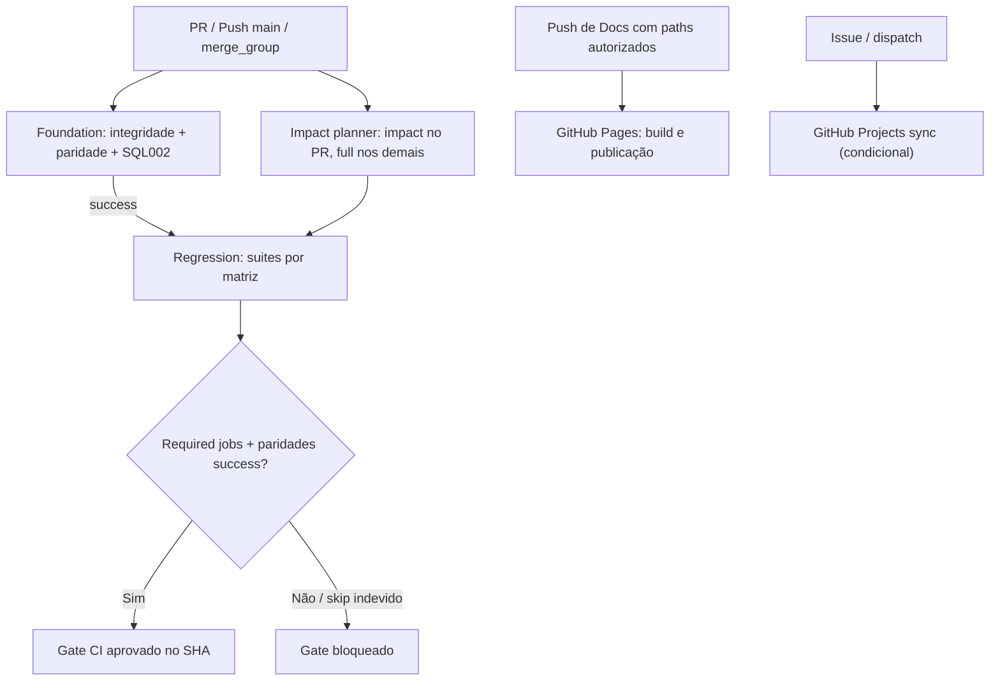

[← Ficha do capítulo](../) · [Volume](../../) · [Fonte original](https://github.com/delmacy/syndes-system/blob/main/docs/subprojects/Q07-ci-cd/chapters/05-arquitetura-banco-interface-configuracao-e-diagramas.md)

> Conteúdo espelhado da documentação versionada; não expressa automaticamente estado funcional.

## 5. Arquitetura do pipeline, banco, interface e diagrama

### Fluxo central (processo e não topologia do SaaS)

As setas de Pages/Projects representam **automações auxiliares**, não um segundo caminho para liberar o `main`.

### Matriz de trigger

| Workflow | `push main` | `pull_request` | `merge_group` | Outros |
|---|---|---|---|---|
| `syndes-ci.yml` | Sim, full | Sim, impact | Sim, full | workflow_dispatch |
| `platform-manager.yml` | Não | Não | Não | workflow_call apenas |
| `support-browser-e2e.yml` | Não | Não | Não | workflow_call apenas |
| `syndes-docs-pages.yml` | Sim, paths escopados | Não | Não | workflow_dispatch |
| `syndes-docs-project-sync.yml` | Não | Não | Não | issues + workflow_dispatch |

### Distinção de dados e interfaces

- **Q07 não possui frontend do produto nem banco próprio**. O GitHub Actions hospeda logs de CI e status de jobs; GitHub Pages hospeda conteúdo documental; Issues/Projects hospedam estado de trabalho quando realmente sincronizado.
- Testes de Serviço montam **PostgreSQL 17 descartável**, não acessam tenant real e limpam container via `trap`. Uma suíte de PG17 aprovada só demonstra o cenário do teste e **não** que o plugin de Serviço foi instalado no Host.
- Suítes Manager/Support/Infra usam cenários mais amplos com identidade e redes; o Gate precisa verificar se foram selecionadas/executadas.
- WBS, commits, CI, deploy e Product Gate são fontes relacionadas, mas diferentes; o portal não converte status de GitHub Actions automaticamente em homologação.

### Riscos e proteção contra falso verde

1. **Testes de paridade são sensíveis ao catálogo de workflows.** Toda nova automação precisa ser classificada e testada; não usar exclusão genérica de tudo que não é `syndes-ci.yml`.
2. **`noop` não ignora foundation.** Docs-only continua exigindo governança e tem publicação separada.
3. **`installedSuites` depende de markers.** Um módulo novo precisa de runner, marker e teste de planner; a ausência silenciosa é risco.
4. **PG17 descartável** deve exigir label/porta/nome e limpeza; qualquer `skip` inesperado invalida a prova.
5. **Release não é CI.** Para ativação real de Serviço, faltam grants, Control ENABLED, backup/restore, SQL operacional, tenant autorizado e Product Gate.

---
**Rastreabilidade:** [revisar documento fonte](https://github.com/delmacy/syndes-system/blob/main/docs/subprojects/Q07-ci-cd/chapters/05-arquitetura-banco-interface-configuracao-e-diagramas.md).
