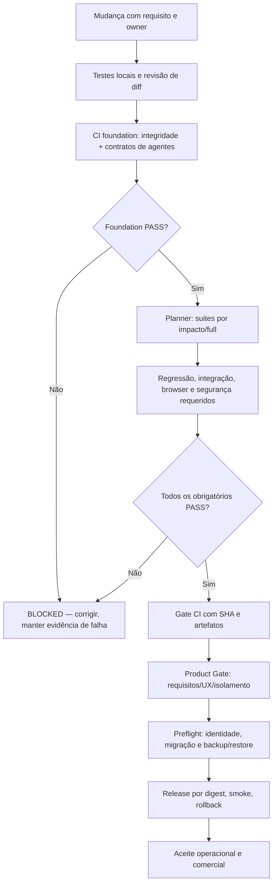

# Q10 — Quality Gates

[← Sumário do volume](../) · [↑ Biblioteca](../../)

> **Leitura técnica, não homologação.** Estados, limites e comprovações devem ser lidos em STATUS e nos checkpoints versionados.

## Identificação e rastreabilidade

| Campo | Fonte verificável |
|---|---|
| Unidade / owner | **Q10** · Quality Gates |
| Volume | Infraestrutura e qualidade |
| Caminho de implementação | `tests/integrity` |
| Documento de origem | [README](https://github.com/delmacy/syndes-system/blob/main/docs/subprojects/Q10-quality-gates/README.md) |
| STATUS e critérios | [STATUS original](https://github.com/delmacy/syndes-system/blob/main/docs/subprojects/Q10-quality-gates/STATUS.md) |
| Símbolos, APIs, SQL e dependências | [REFERENCIA-TECNICA](https://github.com/delmacy/syndes-system/blob/main/docs/subprojects/Q10-quality-gates/REFERENCIA-TECNICA.md) |
| Implantação, runbooks e gates | [OPERACAO](https://github.com/delmacy/syndes-system/blob/main/docs/subprojects/Q10-quality-gates/OPERACAO.md) |

## Situação registrada

> AUDITORIA TÉCNICA PARCIAL — 12/11/2026. Checkout origin/main SHA 69670e27e5c8e22240642f5cde67986ac0e8376b (DevServer01, worktree isolada). Foram examinados os testes de integridade, a estratégia de qualidade, o pipeline e critérios de release. Não foram realizados nesta auditoria testes de produto, identidade real, migrations ou deploy; Quality Gate global não aprovado. Dimensão Situação Evidência e limite --------- Documentação Q10 Auditoria parcial…

A descrição acima é uma **citação resumida do STATUS versionado**; não significa que os testes de integração, a implantação ou a homologação estejam aprovados.

## Índice dos subcapítulos

Todos os assuntos deste módulo estão nesta página. Clique em um título para saltar à seção correspondente; o índice lateral acompanha a leitura.

- [Casos de uso](#casos-de-uso)
- [Histórias de usuário](#historias-de-usuario)
- [Requisitos](#requisitos)
- [Contratos públicos e privados](#contratos)
- [APIs e endpoints](#apis)
- [Eventos e mensageria](#eventos)
- [Dados e persistência](#dados)
- [Schemas e migrations](#schema)
- [Dependências e integrações](#dependencias)
- [Configuração e ambiente](#configuracao)
- [Frontend e interfaces](#interface)
- [Testes e evidências](#testes)
- [Operação e implantação](#operacao)
- [WBS e evolução](#wbs)
- [Documentação de origem integral](#documentacao-de-origem)
- [Controle de alterações](#controle-de-alteracoes)

## Casos de uso

**Editar esta seção:** [Abrir arquivo-fonte no GitHub](https://github.com/delmacy/syndes-system/edit/main/docs/subprojects/Q10-quality-gates/chapters/02-requisitos-historias-e-casos-de-uso.md) · [Consultar fonte](https://github.com/delmacy/syndes-system/blob/main/docs/subprojects/Q10-quality-gates/chapters/02-requisitos-historias-e-casos-de-uso.md)

*Referências extraídas da documentação versionada, sem inferir homologação ou implantação.*

**Fonte:** [02-requisitos-historias-e-casos-de-uso.md](https://github.com/delmacy/syndes-system/blob/main/docs/subprojects/Q10-quality-gates/chapters/02-requisitos-historias-e-casos-de-uso.md)

> Linha 13: \| UX operável \| Usuário real do Workspace/Manager/Support \| Navegador autenticado, loading/erro/403, fluxo E2E, acessibilidade \|

📝 Espaço para ajustes e implementação

Este é um **modelo de registro**, não um editor com salvamento automático. Use o link **Editar esta seção** para atualizar o documento versionado.

- **Alteração proposta:** descreva o requisito, contrato, dado ou comportamento.
- **Referência de código:** informe caminho e símbolo real.
- **Testes e evidências:** informe comando, resultado e limite.
- **Critério de aceite:** indique como validar sem presumir homologação.
- **Status e revisão:** atualize a fonte canônica após revisão.

## Histórias de usuário

**Editar esta seção:** [Abrir arquivo-fonte no GitHub](https://github.com/delmacy/syndes-system/edit/main/docs/subprojects/Q10-quality-gates/chapters/02-requisitos-historias-e-casos-de-uso.md) · [Consultar fonte](https://github.com/delmacy/syndes-system/blob/main/docs/subprojects/Q10-quality-gates/chapters/02-requisitos-historias-e-casos-de-uso.md)

*Referências extraídas da documentação versionada, sem inferir homologação ou implantação.*

**Lacuna documental:** ainda não há especificação textual identificada nesta área. Revisar implementação e registrar evidência antes de preencher.

📝 Espaço para ajustes e implementação

Este é um **modelo de registro**, não um editor com salvamento automático. Use o link **Editar esta seção** para atualizar o documento versionado.

- **Alteração proposta:** descreva o requisito, contrato, dado ou comportamento.
- **Referência de código:** informe caminho e símbolo real.
- **Testes e evidências:** informe comando, resultado e limite.
- **Critério de aceite:** indique como validar sem presumir homologação.
- **Status e revisão:** atualize a fonte canônica após revisão.

## Requisitos

**Editar esta seção:** [Abrir arquivo-fonte no GitHub](https://github.com/delmacy/syndes-system/edit/main/docs/subprojects/Q10-quality-gates/chapters/02-requisitos-historias-e-casos-de-uso.md) · [Consultar fonte](https://github.com/delmacy/syndes-system/blob/main/docs/subprojects/Q10-quality-gates/chapters/02-requisitos-historias-e-casos-de-uso.md)

*Referências extraídas da documentação versionada, sem inferir homologação ou implantação.*

**Fonte:** [02-requisitos-historias-e-casos-de-uso.md](https://github.com/delmacy/syndes-system/blob/main/docs/subprojects/Q10-quality-gates/chapters/02-requisitos-historias-e-casos-de-uso.md)

> Linha 16: \| Aceite \| Produto + engenharia/segurança + operação \| Decisão humana vinculada ao requisito, ambiente e artefato \|

**Fonte:** [07-controle-do-escopo.md](https://github.com/delmacy/syndes-system/blob/main/docs/subprojects/Q10-quality-gates/chapters/07-controle-do-escopo.md)

> Linha 13: \| Definition of Done e Product Gate dissociados \| Q10/G02 e responsáveis \| Matriz de requisitos, evidências, aceites por unidade e release \|

**Fonte:** [REFERENCIA-TECNICA.md](https://github.com/delmacy/syndes-system/blob/main/docs/subprojects/Q10-quality-gates/REFERENCIA-TECNICA.md)

> Linha 35: Q10 **não possui frontend de aplicação**. O portal Syndes Docs indexa matriz de qualidade e STATUS; não controla GitHub Actions, releases, autorização ou ambiente operacional. A interface mostra requisitos e vínculos, não comandos de promoção.

📝 Espaço para ajustes e implementação

Este é um **modelo de registro**, não um editor com salvamento automático. Use o link **Editar esta seção** para atualizar o documento versionado.

- **Alteração proposta:** descreva o requisito, contrato, dado ou comportamento.
- **Referência de código:** informe caminho e símbolo real.
- **Testes e evidências:** informe comando, resultado e limite.
- **Critério de aceite:** indique como validar sem presumir homologação.
- **Status e revisão:** atualize a fonte canônica após revisão.

## Contratos públicos e privados

**Editar esta seção:** [Abrir arquivo-fonte no GitHub](https://github.com/delmacy/syndes-system/edit/main/docs/subprojects/Q10-quality-gates/REFERENCIA-TECNICA.md) · [Consultar fonte](https://github.com/delmacy/syndes-system/blob/main/docs/subprojects/Q10-quality-gates/REFERENCIA-TECNICA.md)

*Referências extraídas da documentação versionada, sem inferir homologação ou implantação.*

**Fonte:** [REFERENCIA-TECNICA.md](https://github.com/delmacy/syndes-system/blob/main/docs/subprojects/Q10-quality-gates/REFERENCIA-TECNICA.md)

> Linha 26: **Q10 não oferece controller HTTP, `package.json#exports`, evento de negócio, port de runtime nem assinatura de schema.** O contrato da Q10 é de **qualidade**: checagem de integridade com exit code, evidência vinculada ao commit e rastreabilidade dos gates.

> Linha 28: - [Contratos públicos dos módulos](../../standards/CONTRATOS-PUBLICOS.md) são verificados por owners, testes de consumidores e API/contratos das unidades responsáveis.

**Fonte:** [04-contratos-e-dependencias-publicas.md](https://github.com/delmacy/syndes-system/blob/main/docs/subprojects/Q10-quality-gates/chapters/04-contratos-e-dependencias-publicas.md)

> Linha 5: **Entrada:** checkout com SHA/branch, catálogo, `AGENTS.md` e arquivos mínimos; **saída:** teste de integridade com exit code e logs, consumido pelo job `foundation`. Q10 **não** publica API HTTP, evento, contrato TypeScript, migration ou serviço de banco de dados. O teste retorna falha se faltarem arquivos ou contratos locais de agente.

> Linha 7: \| Fonte/owner \| Contrato de verificação \| Risco de extrapolação \|

> Linha 11: \| Q02/Q03 — testes por módulo e integração \| Unidades, contratos, integridade de estado e migrations \| Mock/PG descartável ≠ sistema operacional \|

> Linha 22: \| Camada \| Unit, contrato, integração, segurança, E2E, infra, RC, operação \|

**Fonte:** [OPERACAO.md](https://github.com/delmacy/syndes-system/blob/main/docs/subprojects/Q10-quality-gates/OPERACAO.md)

> Linha 16: - [Contratos públicos](../../standards/CONTRATOS-PUBLICOS.md).

> Linha 32: 4. Testar com critérios apropriados: unitário, contrato, integração, E2E e CI.

📝 Espaço para ajustes e implementação

Este é um **modelo de registro**, não um editor com salvamento automático. Use o link **Editar esta seção** para atualizar o documento versionado.

- **Alteração proposta:** descreva o requisito, contrato, dado ou comportamento.
- **Referência de código:** informe caminho e símbolo real.
- **Testes e evidências:** informe comando, resultado e limite.
- **Critério de aceite:** indique como validar sem presumir homologação.
- **Status e revisão:** atualize a fonte canônica após revisão.

## APIs e endpoints

**Editar esta seção:** [Abrir arquivo-fonte no GitHub](https://github.com/delmacy/syndes-system/edit/main/docs/subprojects/Q10-quality-gates/REFERENCIA-TECNICA.md) · [Consultar fonte](https://github.com/delmacy/syndes-system/blob/main/docs/subprojects/Q10-quality-gates/REFERENCIA-TECNICA.md)

*Referências extraídas da documentação versionada, sem inferir homologação ou implantação.*

**Fonte:** [REFERENCIA-TECNICA.md](https://github.com/delmacy/syndes-system/blob/main/docs/subprojects/Q10-quality-gates/REFERENCIA-TECNICA.md)

> Linha 3: > **AUDITORIA ESTÁTICA PARCIAL — 12/11/2026.** Fontes versionadas no checkout `origin/main` SHA `69670e27e5c8e22240642f5cde67986ac0e8376b`. Q10 tem ownership de `tests/integrity`: **não é módulo executável, API, banco, frontend ou engine de testes de todo o Syndes**. As suites transversais pertencem aos respectivos owners.

> Linha 26: **Q10 não oferece controller HTTP, `package.json#exports`, evento de negócio, port de runtime nem assinatura de schema.** O contrato da Q10 é de **qualidade**: checagem de integridade com exit code, evidência vinculada ao commit e rastreabilidade dos gates.

> Linha 28: - [Contratos públicos dos módulos](../../standards/CONTRATOS-PUBLICOS.md) são verificados por owners, testes de consumidores e API/contratos das unidades responsáveis.

> Linha 30: - Product Gate é decisão do responsável, não resposta de endpoint.

**Fonte:** [04-contratos-e-dependencias-publicas.md](https://github.com/delmacy/syndes-system/blob/main/docs/subprojects/Q10-quality-gates/chapters/04-contratos-e-dependencias-publicas.md)

> Linha 5: **Entrada:** checkout com SHA/branch, catálogo, `AGENTS.md` e arquivos mínimos; **saída:** teste de integridade com exit code e logs, consumido pelo job `foundation`. Q10 **não** publica API HTTP, evento, contrato TypeScript, migration ou serviço de banco de dados. O teste retorna falha se faltarem arquivos ou contratos locais de agente.

> Linha 33: Se uma API, evento, port, migration ou política mudar, o owner identifica os consumers e pede suites de regressão pertinentes; novos módulos também precisam ser considerados pelo planner. Alterações em `scripts/ci`, `.github/workflows`, infraestrutura e API pertencem a Q07/owners, **não** à presente revisão da Q10.

**Fonte:** [05-arquitetura-banco-interface-configuracao-e-diagramas.md](https://github.com/delmacy/syndes-system/blob/main/docs/subprojects/Q10-quality-gates/chapters/05-arquitetura-banco-interface-configuracao-e-diagramas.md)

> Linha 30: \| **Integração/contrato** \| Q03 + módulos; API/PG/migrations/events/idempotência \| Só integração no ambiente do ensaio \|

> Linha 48: - Q10 **não mantém banco PostgreSQL, migrations, tabelas ou API REST**. Fonte: scripts, resultados de CI, WBS e documentos versionados.

📝 Espaço para ajustes e implementação

Este é um **modelo de registro**, não um editor com salvamento automático. Use o link **Editar esta seção** para atualizar o documento versionado.

- **Alteração proposta:** descreva o requisito, contrato, dado ou comportamento.
- **Referência de código:** informe caminho e símbolo real.
- **Testes e evidências:** informe comando, resultado e limite.
- **Critério de aceite:** indique como validar sem presumir homologação.
- **Status e revisão:** atualize a fonte canônica após revisão.

## Eventos e mensageria

**Editar esta seção:** [Abrir arquivo-fonte no GitHub](https://github.com/delmacy/syndes-system/edit/main/docs/subprojects/Q10-quality-gates/REFERENCIA-TECNICA.md) · [Consultar fonte](https://github.com/delmacy/syndes-system/blob/main/docs/subprojects/Q10-quality-gates/REFERENCIA-TECNICA.md)

*Referências extraídas da documentação versionada, sem inferir homologação ou implantação.*

**Fonte:** [REFERENCIA-TECNICA.md](https://github.com/delmacy/syndes-system/blob/main/docs/subprojects/Q10-quality-gates/REFERENCIA-TECNICA.md)

> Linha 26: **Q10 não oferece controller HTTP, `package.json#exports`, evento de negócio, port de runtime nem assinatura de schema.** O contrato da Q10 é de **qualidade**: checagem de integridade com exit code, evidência vinculada ao commit e rastreabilidade dos gates.

**Fonte:** [04-contratos-e-dependencias-publicas.md](https://github.com/delmacy/syndes-system/blob/main/docs/subprojects/Q10-quality-gates/chapters/04-contratos-e-dependencias-publicas.md)

> Linha 5: **Entrada:** checkout com SHA/branch, catálogo, `AGENTS.md` e arquivos mínimos; **saída:** teste de integridade com exit code e logs, consumido pelo job `foundation`. Q10 **não** publica API HTTP, evento, contrato TypeScript, migration ou serviço de banco de dados. O teste retorna falha se faltarem arquivos ou contratos locais de agente.

> Linha 33: Se uma API, evento, port, migration ou política mudar, o owner identifica os consumers e pede suites de regressão pertinentes; novos módulos também precisam ser considerados pelo planner. Alterações em `scripts/ci`, `.github/workflows`, infraestrutura e API pertencem a Q07/owners, **não** à presente revisão da Q10.

**Fonte:** [05-arquitetura-banco-interface-configuracao-e-diagramas.md](https://github.com/delmacy/syndes-system/blob/main/docs/subprojects/Q10-quality-gates/chapters/05-arquitetura-banco-interface-configuracao-e-diagramas.md)

> Linha 42: \| Event Outbox/worker \| Teste de lease, transaction, idempotência e ENABLED; PG17 sintético não autoriza worker ativo \|

> Linha 43: \| CI faltante/falho \| Não considerar `DONE`, ainda que Docs Pages tenha publicado \|

📝 Espaço para ajustes e implementação

Este é um **modelo de registro**, não um editor com salvamento automático. Use o link **Editar esta seção** para atualizar o documento versionado.

- **Alteração proposta:** descreva o requisito, contrato, dado ou comportamento.
- **Referência de código:** informe caminho e símbolo real.
- **Testes e evidências:** informe comando, resultado e limite.
- **Critério de aceite:** indique como validar sem presumir homologação.
- **Status e revisão:** atualize a fonte canônica após revisão.

## Dados e persistência

**Editar esta seção:** [Abrir arquivo-fonte no GitHub](https://github.com/delmacy/syndes-system/edit/main/docs/subprojects/Q10-quality-gates/REFERENCIA-TECNICA.md) · [Consultar fonte](https://github.com/delmacy/syndes-system/blob/main/docs/subprojects/Q10-quality-gates/REFERENCIA-TECNICA.md)

*Referências extraídas da documentação versionada, sem inferir homologação ou implantação.*

**Fonte:** [REFERENCIA-TECNICA.md](https://github.com/delmacy/syndes-system/blob/main/docs/subprojects/Q10-quality-gates/REFERENCIA-TECNICA.md)

> Linha 39: **Q10 não possui tabelas PostgreSQL, schema próprio, migrations nem dependência de banco operacional.** Os testes de migrations e restore estão sob ownership de módulos, infraestrutura e equipes de qualidade; prova descartável de PostgreSQL não equivale a migration aplicada/backup restaurado em produção.

**Fonte:** [04-contratos-e-dependencias-publicas.md](https://github.com/delmacy/syndes-system/blob/main/docs/subprojects/Q10-quality-gates/chapters/04-contratos-e-dependencias-publicas.md)

> Linha 5: **Entrada:** checkout com SHA/branch, catálogo, `AGENTS.md` e arquivos mínimos; **saída:** teste de integridade com exit code e logs, consumido pelo job `foundation`. Q10 **não** publica API HTTP, evento, contrato TypeScript, migration ou serviço de banco de dados. O teste retorna falha se faltarem arquivos ou contratos locais de agente.

> Linha 29: **Falha fechada:** se um job requerido falhar, for cancelado ou ficar `skipped` sem razão permitida, o gate reprova. Um resultado `NOT_RUN` não pode virar `PASS` com checklist manual. Não copiar dados pessoais/segredos de execução em logs públicos.

**Fonte:** [05-arquitetura-banco-interface-configuracao-e-diagramas.md](https://github.com/delmacy/syndes-system/blob/main/docs/subprojects/Q10-quality-gates/chapters/05-arquitetura-banco-interface-configuracao-e-diagramas.md)

> Linha 48: - Q10 **não mantém banco PostgreSQL, migrations, tabelas ou API REST**. Fonte: scripts, resultados de CI, WBS e documentos versionados.

**Fonte:** [STATUS.md](https://github.com/delmacy/syndes-system/blob/main/docs/subprojects/Q10-quality-gates/STATUS.md)

> Linha 21: \| `tests/integrity/repository-structure.sh` \| Verifica arquivos obrigatórios/AGENTS e chama `scripts/architecture/check-work-units.mjs` \| Implementação/teste do negócio ou segurança dos dados \|

📝 Espaço para ajustes e implementação

Este é um **modelo de registro**, não um editor com salvamento automático. Use o link **Editar esta seção** para atualizar o documento versionado.

- **Alteração proposta:** descreva o requisito, contrato, dado ou comportamento.
- **Referência de código:** informe caminho e símbolo real.
- **Testes e evidências:** informe comando, resultado e limite.
- **Critério de aceite:** indique como validar sem presumir homologação.
- **Status e revisão:** atualize a fonte canônica após revisão.

## Schemas e migrations

**Editar esta seção:** [Abrir arquivo-fonte no GitHub](https://github.com/delmacy/syndes-system/edit/main/docs/subprojects/Q10-quality-gates/REFERENCIA-TECNICA.md) · [Consultar fonte](https://github.com/delmacy/syndes-system/blob/main/docs/subprojects/Q10-quality-gates/REFERENCIA-TECNICA.md)

*Referências extraídas da documentação versionada, sem inferir homologação ou implantação.*

**Fonte:** [REFERENCIA-TECNICA.md](https://github.com/delmacy/syndes-system/blob/main/docs/subprojects/Q10-quality-gates/REFERENCIA-TECNICA.md)

> Linha 26: **Q10 não oferece controller HTTP, `package.json#exports`, evento de negócio, port de runtime nem assinatura de schema.** O contrato da Q10 é de **qualidade**: checagem de integridade com exit code, evidência vinculada ao commit e rastreabilidade dos gates.

> Linha 39: **Q10 não possui tabelas PostgreSQL, schema próprio, migrations nem dependência de banco operacional.** Os testes de migrations e restore estão sob ownership de módulos, infraestrutura e equipes de qualidade; prova descartável de PostgreSQL não equivale a migration aplicada/backup restaurado em produção.

**Fonte:** [04-contratos-e-dependencias-publicas.md](https://github.com/delmacy/syndes-system/blob/main/docs/subprojects/Q10-quality-gates/chapters/04-contratos-e-dependencias-publicas.md)

> Linha 5: **Entrada:** checkout com SHA/branch, catálogo, `AGENTS.md` e arquivos mínimos; **saída:** teste de integridade com exit code e logs, consumido pelo job `foundation`. Q10 **não** publica API HTTP, evento, contrato TypeScript, migration ou serviço de banco de dados. O teste retorna falha se faltarem arquivos ou contratos locais de agente.

> Linha 11: \| Q02/Q03 — testes por módulo e integração \| Unidades, contratos, integridade de estado e migrations \| Mock/PG descartável ≠ sistema operacional \|

> Linha 33: Se uma API, evento, port, migration ou política mudar, o owner identifica os consumers e pede suites de regressão pertinentes; novos módulos também precisam ser considerados pelo planner. Alterações em `scripts/ci`, `.github/workflows`, infraestrutura e API pertencem a Q07/owners, **não** à presente revisão da Q10.

**Fonte:** [05-arquitetura-banco-interface-configuracao-e-diagramas.md](https://github.com/delmacy/syndes-system/blob/main/docs/subprojects/Q10-quality-gates/chapters/05-arquitetura-banco-interface-configuracao-e-diagramas.md)

> Linha 30: \| **Integração/contrato** \| Q03 + módulos; API/PG/migrations/events/idempotência \| Só integração no ambiente do ensaio \|

> Linha 48: - Q10 **não mantém banco PostgreSQL, migrations, tabelas ou API REST**. Fonte: scripts, resultados de CI, WBS e documentos versionados.

**Fonte:** [STATUS.md](https://github.com/delmacy/syndes-system/blob/main/docs/subprojects/Q10-quality-gates/STATUS.md)

> Linha 3: > **AUDITORIA TÉCNICA PARCIAL — 12/11/2026.** Checkout `origin/main` SHA `69670e27e5c8e22240642f5cde67986ac0e8376b` (DevServer01, worktree isolada). Foram examinados os testes de integridade, a estratégia de qualidade, o pipeline e critérios de release. Não foram realizados nesta auditoria testes de produto, identidade real, migrations ou deploy; **Quality Gate global não aprovado**.

> Linha 32: 4. **Segurança/tenancy:** não foram testadas nesta auditoria negações cross-tenant, Keycloak/OpenFGA real, SQL com tenant A/B, multi-org nem identidade service.

**Fonte:** [OPERACAO.md](https://github.com/delmacy/syndes-system/blob/main/docs/subprojects/Q10-quality-gates/OPERACAO.md)

> Linha 3: > **ÍNDICE DE FONTES, NÃO RUNBOOK HOMOLOGADO.** Não executar migrations, alterar permissões ou ativar workers apenas com esta página.

> Linha 31: 3. Confirmar migrations realmente aplicadas, backup/restore e rollback antes de SQL.

📝 Espaço para ajustes e implementação

Este é um **modelo de registro**, não um editor com salvamento automático. Use o link **Editar esta seção** para atualizar o documento versionado.

- **Alteração proposta:** descreva o requisito, contrato, dado ou comportamento.
- **Referência de código:** informe caminho e símbolo real.
- **Testes e evidências:** informe comando, resultado e limite.
- **Critério de aceite:** indique como validar sem presumir homologação.
- **Status e revisão:** atualize a fonte canônica após revisão.

## Dependências e integrações

**Editar esta seção:** [Abrir arquivo-fonte no GitHub](https://github.com/delmacy/syndes-system/edit/main/docs/subprojects/Q10-quality-gates/REFERENCIA-TECNICA.md) · [Consultar fonte](https://github.com/delmacy/syndes-system/blob/main/docs/subprojects/Q10-quality-gates/REFERENCIA-TECNICA.md)

*Referências extraídas da documentação versionada, sem inferir homologação ou implantação.*

**Fonte:** [REFERENCIA-TECNICA.md](https://github.com/delmacy/syndes-system/blob/main/docs/subprojects/Q10-quality-gates/REFERENCIA-TECNICA.md)

> Linha 8: - **Dependências de processo:** `scripts/architecture/check-work-units.mjs`, `catalog/work-units.json` e `AGENTS.md` nos módulos.

> Linha 29: - Unit, integração, E2E, segurança, infra e performance pertencem a Q02/Q03/Q04/Q05/Q09/Q06 e seus módulos.

> Linha 39: **Q10 não possui tabelas PostgreSQL, schema próprio, migrations nem dependência de banco operacional.** Os testes de migrations e restore estão sob ownership de módulos, infraestrutura e equipes de qualidade; prova descartável de PostgreSQL não equivale a migration aplicada/backup restaurado em produção.

**Fonte:** [04-contratos-e-dependencias-publicas.md](https://github.com/delmacy/syndes-system/blob/main/docs/subprojects/Q10-quality-gates/chapters/04-contratos-e-dependencias-publicas.md)

> Linha 11: \| Q02/Q03 — testes por módulo e integração \| Unidades, contratos, integridade de estado e migrations \| Mock/PG descartável ≠ sistema operacional \|

> Linha 12: \| Q04/Q05 — browser, identidade e segurança \| E2E com perfis, autorização, isolamento e falha segura \| Token fictício não comprova Keycloak/OpenFGA real \|

> Linha 21: \| Revisão \| SHA integral, árvore/artefato e dependências relevantes \|

> Linha 22: \| Camada \| Unit, contrato, integração, segurança, E2E, infra, RC, operação \|

**Fonte:** [05-arquitetura-banco-interface-configuracao-e-diagramas.md](https://github.com/delmacy/syndes-system/blob/main/docs/subprojects/Q10-quality-gates/chapters/05-arquitetura-banco-interface-configuracao-e-diagramas.md)

> Linha 30: \| **Integração/contrato** \| Q03 + módulos; API/PG/migrations/events/idempotência \| Só integração no ambiente do ensaio \|

> Linha 40: \| Erro OpenFGA/Keycloak \| Sem fallback permissivo, operação negada e auditoria sanitizada \|

**Fonte:** [STATUS.md](https://github.com/delmacy/syndes-system/blob/main/docs/subprojects/Q10-quality-gates/STATUS.md)

> Linha 11: \| **Integração CI** \| **Falha de paridade em mainline** \| [Run 43335397128](https://github.com/delmacy/syndes-system/actions/runs/43335397128), SHA `69670e2`: job `foundation` reprovou paridade; gate global falhou \|

> Linha 12: \| **Suites de negócio, autorização e integração** \| **Não reexecutadas pela Q10** \| Q02–Q09 e owners; não usar scripts existentes como evidência de testes aprovados \|

> Linha 32: 4. **Segurança/tenancy:** não foram testadas nesta auditoria negações cross-tenant, Keycloak/OpenFGA real, SQL com tenant A/B, multi-org nem identidade service.

> Linha 41: - **Próxima unidade:** Q07 — CI central (documentar/paridade e dependências). Alterações executáveis na CI exigem frente própria autorizada, sem enfraquecer testes.

**Fonte:** [OPERACAO.md](https://github.com/delmacy/syndes-system/blob/main/docs/subprojects/Q10-quality-gates/OPERACAO.md)

> Linha 9: - [Evolução](EVOLUCAO.md): workpackages e dependências; nenhum item é concluído por estar planejado.

> Linha 32: 4. Testar com critérios apropriados: unitário, contrato, integração, E2E e CI.

📝 Espaço para ajustes e implementação

Este é um **modelo de registro**, não um editor com salvamento automático. Use o link **Editar esta seção** para atualizar o documento versionado.

- **Alteração proposta:** descreva o requisito, contrato, dado ou comportamento.
- **Referência de código:** informe caminho e símbolo real.
- **Testes e evidências:** informe comando, resultado e limite.
- **Critério de aceite:** indique como validar sem presumir homologação.
- **Status e revisão:** atualize a fonte canônica após revisão.

## Configuração e ambiente

**Editar esta seção:** [Abrir arquivo-fonte no GitHub](https://github.com/delmacy/syndes-system/edit/main/docs/subprojects/Q10-quality-gates/OPERACAO.md) · [Consultar fonte](https://github.com/delmacy/syndes-system/blob/main/docs/subprojects/Q10-quality-gates/OPERACAO.md)

*Referências extraídas da documentação versionada, sem inferir homologação ou implantação.*

**Lacuna documental:** ainda não há especificação textual identificada nesta área. Revisar implementação e registrar evidência antes de preencher.

📝 Espaço para ajustes e implementação

Este é um **modelo de registro**, não um editor com salvamento automático. Use o link **Editar esta seção** para atualizar o documento versionado.

- **Alteração proposta:** descreva o requisito, contrato, dado ou comportamento.
- **Referência de código:** informe caminho e símbolo real.
- **Testes e evidências:** informe comando, resultado e limite.
- **Critério de aceite:** indique como validar sem presumir homologação.
- **Status e revisão:** atualize a fonte canônica após revisão.

## Frontend e interfaces

**Editar esta seção:** [Abrir arquivo-fonte no GitHub](https://github.com/delmacy/syndes-system/edit/main/docs/subprojects/Q10-quality-gates/REFERENCIA-TECNICA.md) · [Consultar fonte](https://github.com/delmacy/syndes-system/blob/main/docs/subprojects/Q10-quality-gates/REFERENCIA-TECNICA.md)

*Referências extraídas da documentação versionada, sem inferir homologação ou implantação.*

**Fonte:** [REFERENCIA-TECNICA.md](https://github.com/delmacy/syndes-system/blob/main/docs/subprojects/Q10-quality-gates/REFERENCIA-TECNICA.md)

> Linha 3: > **AUDITORIA ESTÁTICA PARCIAL — 12/11/2026.** Fontes versionadas no checkout `origin/main` SHA `69670e27e5c8e22240642f5cde67986ac0e8376b`. Q10 tem ownership de `tests/integrity`: **não é módulo executável, API, banco, frontend ou engine de testes de todo o Syndes**. As suites transversais pertencem aos respectivos owners.

> Linha 14: \| Fonte \| Comando ou interface \| Efeito observável pelo código \|

> Linha 35: Q10 **não possui frontend de aplicação**. O portal Syndes Docs indexa matriz de qualidade e STATUS; não controla GitHub Actions, releases, autorização ou ambiente operacional. A interface mostra requisitos e vínculos, não comandos de promoção.

📝 Espaço para ajustes e implementação

Este é um **modelo de registro**, não um editor com salvamento automático. Use o link **Editar esta seção** para atualizar o documento versionado.

- **Alteração proposta:** descreva o requisito, contrato, dado ou comportamento.
- **Referência de código:** informe caminho e símbolo real.
- **Testes e evidências:** informe comando, resultado e limite.
- **Critério de aceite:** indique como validar sem presumir homologação.
- **Status e revisão:** atualize a fonte canônica após revisão.

## Testes e evidências

**Editar esta seção:** [Abrir arquivo-fonte no GitHub](https://github.com/delmacy/syndes-system/edit/main/docs/subprojects/Q10-quality-gates/STATUS.md) · [Consultar fonte](https://github.com/delmacy/syndes-system/blob/main/docs/subprojects/Q10-quality-gates/STATUS.md)

*Referências extraídas da documentação versionada, sem inferir homologação ou implantação.*

**Fonte:** [STATUS.md](https://github.com/delmacy/syndes-system/blob/main/docs/subprojects/Q10-quality-gates/STATUS.md)

> Linha 3: > **AUDITORIA TÉCNICA PARCIAL — 12/11/2026.** Checkout `origin/main` SHA `69670e27e5c8e22240642f5cde67986ac0e8376b` (DevServer01, worktree isolada). Foram examinados os testes de integridade, a estratégia de qualidade, o pipeline e critérios de release. Não foram realizados nesta auditoria testes de produto, identidade real, migrations ou deploy; **Quality Gate global não aprovado**.

> Linha 7: \| Dimensão \| Situação \| Evidência e limite \|

> Linha 9: \| **Documentação Q10** \| **Auditoria parcial** \| Capítulos 00–07, matriz de gates/risco, ownership e evidências reconciliados; aprovação de responsáveis pendente \|

> Linha 10: \| **Implementação Q10** \| **Teste estrutural encontrado** \| `tests/integrity/repository-structure.sh`, `tests/integrity/AGENTS.md` e `scripts/architecture/check-work-units.mjs`; capacidade restrita à integridade da estrutura \|

> Linha 11: \| **Integração CI** \| **Falha de paridade em mainline** \| [Run 43335397128](https://github.com/delmacy/syndes-system/actions/runs/43335397128), SHA `69670e2`: job `foundation` reprovou paridade; gate global falhou \|

> Linha 12: \| **Suites de negócio, autorização e integração** \| **Não reexecutadas pela Q10** \| Q02–Q09 e owners; não usar scripts existentes como evidência de testes aprovados \|

> Linha 14: \| **Product Gate** \| **Não aprovado pela auditoria** \| Produto/Segurança/Operação devem assinar aceite por cenário e ambiente \|

> Linha 20: \| `catalog/work-units.json`; `tests/integrity/AGENTS.md` \| Q10 tem owner `tests/integrity`; testes rápidos de estrutura requeridos em pushes/PRs \| Cobertura semântica de todos os módulos \|

> Linha 21: \| `tests/integrity/repository-structure.sh` \| Verifica arquivos obrigatórios/AGENTS e chama `scripts/architecture/check-work-units.mjs` \| Implementação/teste do negócio ou segurança dos dados \|

> Linha 22: \| `.github/workflows/syndes-ci.yml` \| Jobs de foundation/impact/regression/paridade e gate fail-closed \| CI verde do SHA \|

> Linha 25: \| `SYNDES-SUPPORT-RELEASE-GATE.md`, `INTEGRATED-RELEASE-CANDIDATE-20261109.md` \| Preflight de identidade, backups, digest, rollback e sign-off como condições \| Homologação operacional atual ou deploy autorizado \|

> Linha 30: 2. **Cobertura do planner:** o catálogo de suites verificado não lista explicitamente `service-management`, apesar de haver esse módulo. O owner Q07 precisa avaliar testes obrigatórios para novos módulos e não mascarar a lacuna com CI verde.

> Linha 31: 3. **Testes estruturais são insuficientes:** Q10 verifica presença/ownership; os demais gates são de Q02/Q03/Q04/Q05/Q06/Q08/Q09 e owners, com evidência por SHA/ambiente.

> Linha 34: 6. **WBS e Product Gate:** tarefas 00.08, 70.09, 95.01, 95.06 e 95.07 são vínculos históricos, não conclusões de entrega.

> Linha 38: - [ESCOPO](ESCOPO.md): critérios por camada de teste, histórias, matrizes de responsabilidade e sequência de gates.

> Linha 39: - [Referência técnica](REFERENCIA-TECNICA.md): comandos e scripts reais, limites do teste estrutural, sem APIs inventadas.

> Linha 41: - **Próxima unidade:** Q07 — CI central (documentar/paridade e dependências). Alterações executáveis na CI exigem frente própria autorizada, sem enfraquecer testes.

> Linha 45: \| 2026-11-12 \| `69670e27e5c8e22240642f5cde67986ac0e8376b` · DevServer01/worktree isolada \| Leitura de AGENTS, shell, planner, workflows, WBS e run GitHub \| Testes de negócio, CI global aprovado, release, sign-off \|

**Fonte:** [06-wbs-marcos-e-aceite.md](https://github.com/delmacy/syndes-system/blob/main/docs/subprojects/Q10-quality-gates/chapters/06-wbs-marcos-e-aceite.md)

> Linha 5: \| Marco WBS \| Entregável original \| Estado histórico / evidência que falta \|

> Linha 8: \| 70.09 \| Product Gate individual por módulo \| **PEND**; exigir aceite por owner e cenário real \|

> Linha 9: \| 95.01 \| Definition of Done e evidência transversal \| **PEND**; formalização e assinatura por responsáveis \|

> Linha 15: \| Item \| Evidência produzida \| Situação \|

> Linha 19: \| Q10.DOC.03 — proposta documental \| Checkpoint de CI verde e Product Gates para próximos releases \| **Bloqueada por evidência** \|

> Linha 24: 2. Pipeline principal verde **no SHA indicado**, sem remover ou ignorar testes de paridade.

> Linha 26: 4. Evidência reproduzível de um fluxo completo: requisito/owner → mudança → CI → ambiente → autorização → gate/aceite.

> Linha 27: 5. Product Gate/Release operacional só quando o responsável aprovar; não promover Q10 inteira por ter testado arquivos estruturais.

**Fonte:** [REFERENCIA-TECNICA.md](https://github.com/delmacy/syndes-system/blob/main/docs/subprojects/Q10-quality-gates/REFERENCIA-TECNICA.md)

> Linha 3: > **AUDITORIA ESTÁTICA PARCIAL — 12/11/2026.** Fontes versionadas no checkout `origin/main` SHA `69670e27e5c8e22240642f5cde67986ac0e8376b`. Q10 tem ownership de `tests/integrity`: **não é módulo executável, API, banco, frontend ou engine de testes de todo o Syndes**. As suites transversais pertencem aos respectivos owners.

> Linha 9: - **Composição de CI:** `.github/workflows/syndes-ci.yml` → `foundation`, `impact`, `regression`, `support-browser-parity`, `platform-manager-parity` e `gate`.

> Linha 10: - **Estratégia de testes:** [TEST-STRATEGY](https://github.com/delmacy/syndes-system/blob/main/docs/engineering/TEST-STRATEGY.md) define camadas e RC. Ela não comprova que todas as camadas estejam automatizadas, executadas ou aprovadas.

> Linha 18: \| `scripts/ci/plan.mjs` (Q07) \| `selectSuites`, `installedSuites`, modos impact/full \| Determina suites a partir de caminhos e lockfiles encontrados; não é gate em si \|

> Linha 26: **Q10 não oferece controller HTTP, `package.json#exports`, evento de negócio, port de runtime nem assinatura de schema.** O contrato da Q10 é de **qualidade**: checagem de integridade com exit code, evidência vinculada ao commit e rastreabilidade dos gates.

> Linha 28: - [Contratos públicos dos módulos](../../standards/CONTRATOS-PUBLICOS.md) são verificados por owners, testes de consumidores e API/contratos das unidades responsáveis.

> Linha 30: - Product Gate é decisão do responsável, não resposta de endpoint.

> Linha 31: - `syndes-ci.yml` falhando em paridade **não pode ser aprovado** por novo link do Docs ou por execução local de teste de estrutura.

> Linha 39: **Q10 não possui tabelas PostgreSQL, schema próprio, migrations nem dependência de banco operacional.** Os testes de migrations e restore estão sob ownership de módulos, infraestrutura e equipes de qualidade; prova descartável de PostgreSQL não equivale a migration aplicada/backup restaurado em produção.

> Linha 43: - **Gate estrutural:** `tests/integrity/repository-structure.sh`, AGENTS locais e catálogo.

> Linha 44: - **Gate CI central:** `syndes-ci.yml` usa `foundation` + seleção por impacto/full; [falha observada no run 43335397128](https://github.com/delmacy/syndes-system/actions/runs/43335397128), com paridade reprovada.

**Fonte:** [OPERACAO.md](https://github.com/delmacy/syndes-system/blob/main/docs/subprojects/Q10-quality-gates/OPERACAO.md)

> Linha 7: - [STATUS](STATUS.md): nível de validação, bloqueios, testes, ambiente e SHA.

> Linha 32: 4. Testar com critérios apropriados: unitário, contrato, integração, E2E e CI.

> Linha 33: 5. Registrar resultado e evidência em STATUS, sem confundir merge com deploy ou aceite.

📝 Espaço para ajustes e implementação

Este é um **modelo de registro**, não um editor com salvamento automático. Use o link **Editar esta seção** para atualizar o documento versionado.

- **Alteração proposta:** descreva o requisito, contrato, dado ou comportamento.
- **Referência de código:** informe caminho e símbolo real.
- **Testes e evidências:** informe comando, resultado e limite.
- **Critério de aceite:** indique como validar sem presumir homologação.
- **Status e revisão:** atualize a fonte canônica após revisão.

## Operação e implantação

**Editar esta seção:** [Abrir arquivo-fonte no GitHub](https://github.com/delmacy/syndes-system/edit/main/docs/subprojects/Q10-quality-gates/OPERACAO.md) · [Consultar fonte](https://github.com/delmacy/syndes-system/blob/main/docs/subprojects/Q10-quality-gates/OPERACAO.md)

*Referências extraídas da documentação versionada, sem inferir homologação ou implantação.*

**Fonte:** [OPERACAO.md](https://github.com/delmacy/syndes-system/blob/main/docs/subprojects/Q10-quality-gates/OPERACAO.md)

> Linha 31: 3. Confirmar migrations realmente aplicadas, backup/restore e rollback antes de SQL.

> Linha 33: 5. Registrar resultado e evidência em STATUS, sem confundir merge com deploy ou aceite.

**Fonte:** [05-arquitetura-banco-interface-configuracao-e-diagramas.md](https://github.com/delmacy/syndes-system/blob/main/docs/subprojects/Q10-quality-gates/chapters/05-arquitetura-banco-interface-configuracao-e-diagramas.md)

> Linha 33: \| **Operação/Produto** \| Produtor de release, segurança, operador e responsável do produto \| Homologação somente por aceite explícito \|

> Linha 40: \| Erro OpenFGA/Keycloak \| Sem fallback permissivo, operação negada e auditoria sanitizada \|

> Linha 41: \| Migração \| Sem backup/restore/rollback e aprovação por owner, **não aplicar em ambiente real** \|

**Fonte:** [06-wbs-marcos-e-aceite.md](https://github.com/delmacy/syndes-system/blob/main/docs/subprojects/Q10-quality-gates/chapters/06-wbs-marcos-e-aceite.md)

> Linha 11: \| 95.07 \| Janela de produção e rollback explícitos \| **BLOQ**; digests, backups, janela e responsáveis \|

> Linha 18: \| Q10.DOC.02 — proposta documental \| Revisão de critérios transversais com Q07, QA, segurança e operação \| **Ainda não aprovada** \|

**Fonte:** [STATUS.md](https://github.com/delmacy/syndes-system/blob/main/docs/subprojects/Q10-quality-gates/STATUS.md)

> Linha 3: > **AUDITORIA TÉCNICA PARCIAL — 12/11/2026.** Checkout `origin/main` SHA `69670e27e5c8e22240642f5cde67986ac0e8376b` (DevServer01, worktree isolada). Foram examinados os testes de integridade, a estratégia de qualidade, o pipeline e critérios de release. Não foram realizados nesta auditoria testes de produto, identidade real, migrations ou deploy; **Quality Gate global não aprovado**.

> Linha 13: \| **Release/Operação** \| **Não verificados** \| Sem smoke real, backup/restore operacional, staging/produção, digest de release, rollback ou aceite nesta revisão \|

> Linha 14: \| **Product Gate** \| **Não aprovado pela auditoria** \| Produto/Segurança/Operação devem assinar aceite por cenário e ambiente \|

> Linha 25: \| `SYNDES-SUPPORT-RELEASE-GATE.md`, `INTEGRATED-RELEASE-CANDIDATE-20261109.md` \| Preflight de identidade, backups, digest, rollback e sign-off como condições \| Homologação operacional atual ou deploy autorizado \|

> Linha 33: 5. **Release:** não há nesta revisão prova de backup/restore real, rollout, rollback, smoke, observabilidade ou aceite de operações.

📝 Espaço para ajustes e implementação

Este é um **modelo de registro**, não um editor com salvamento automático. Use o link **Editar esta seção** para atualizar o documento versionado.

- **Alteração proposta:** descreva o requisito, contrato, dado ou comportamento.
- **Referência de código:** informe caminho e símbolo real.
- **Testes e evidências:** informe comando, resultado e limite.
- **Critério de aceite:** indique como validar sem presumir homologação.
- **Status e revisão:** atualize a fonte canônica após revisão.

## WBS e evolução

**Editar esta seção:** [Abrir arquivo-fonte no GitHub](https://github.com/delmacy/syndes-system/edit/main/docs/subprojects/Q10-quality-gates/STATUS.md) · [Consultar fonte](https://github.com/delmacy/syndes-system/blob/main/docs/subprojects/Q10-quality-gates/STATUS.md)

*Referências extraídas da documentação versionada, sem inferir homologação ou implantação.*

**Fonte:** [STATUS.md](https://github.com/delmacy/syndes-system/blob/main/docs/subprojects/Q10-quality-gates/STATUS.md)

> Linha 9: \| **Documentação Q10** \| **Auditoria parcial** \| Capítulos 00–07, matriz de gates/risco, ownership e evidências reconciliados; aprovação de responsáveis pendente \|

> Linha 34: 6. **WBS e Product Gate:** tarefas 00.08, 70.09, 95.01, 95.06 e 95.07 são vínculos históricos, não conclusões de entrega.

> Linha 45: \| 2026-11-12 \| `69670e27e5c8e22240642f5cde67986ac0e8376b` · DevServer01/worktree isolada \| Leitura de AGENTS, shell, planner, workflows, WBS e run GitHub \| Testes de negócio, CI global aprovado, release, sign-off \|

**Fonte:** [06-wbs-marcos-e-aceite.md](https://github.com/delmacy/syndes-system/blob/main/docs/subprojects/Q10-quality-gates/chapters/06-wbs-marcos-e-aceite.md)

> Linha 3: A [EVOLUÇÃO](../EVOLUCAO.md) associa a Q10 aos IDs da [WBS mestre](../../../engineering/WBS-PROGRAMA-SYNDES-20261110.md): **00.08, 70.09, 95.01, 95.06 e 95.07**. Essa associação não significa tarefa concluída nem que Q10 executa os contratos de todos os owners.

> Linha 5: \| Marco WBS \| Entregável original \| Estado histórico / evidência que falta \|

> Linha 7: \| 00.08 \| Revalidar release candidate integrado \| **BLOQ** na WBS; regressão central e integrações não aprovadas \|

**Fonte:** [07-controle-do-escopo.md](https://github.com/delmacy/syndes-system/blob/main/docs/subprojects/Q10-quality-gates/chapters/07-controle-do-escopo.md)

> Linha 14: \| WBS histórica versus CI/Project/STATUS \| G03/Q10 e owners \| Link para fonte correta, sem estados de progresso duplicados \|

> Linha 22: A auditoria Q10 ficará **parcial** até validação das políticas, CI saudável, cobertura de suites e evidências dos owners. A continuidade documental encaminha Q07; não cria automaticamente uma nova sprint de CI nem altera cronograma.

**Fonte:** [REFERENCIA-TECNICA.md](https://github.com/delmacy/syndes-system/blob/main/docs/subprojects/Q10-quality-gates/REFERENCIA-TECNICA.md)

> Linha 46: - [STATUS Q10](STATUS.md) expõe bloqueios, fontes e próximos passos; [WBS](EVOLUCAO.md) mantém os cinco IDs associados sem inventar progresso.

**Fonte:** [OPERACAO.md](https://github.com/delmacy/syndes-system/blob/main/docs/subprojects/Q10-quality-gates/OPERACAO.md)

> Linha 8: - [SPRINT](SPRINT.md): incremento autorizado e checkpoints, quando existentes.

📝 Espaço para ajustes e implementação

Este é um **modelo de registro**, não um editor com salvamento automático. Use o link **Editar esta seção** para atualizar o documento versionado.

- **Alteração proposta:** descreva o requisito, contrato, dado ou comportamento.
- **Referência de código:** informe caminho e símbolo real.
- **Testes e evidências:** informe comando, resultado e limite.
- **Critério de aceite:** indique como validar sem presumir homologação.
- **Status e revisão:** atualize a fonte canônica após revisão.

## Documentação de origem integral

Os oito assuntos canônicos são reproduzidos abaixo para permitir leitura contínua. As fontes versionadas permanecem editáveis e preservadas.

### 00 · Fontes e endereços

[Editar conteúdo original](https://github.com/delmacy/syndes-system/edit/main/docs/subprojects/Q10-quality-gates/chapters/00-enderecos-exatos-de-leitura.md) · [Abrir fonte](https://github.com/delmacy/syndes-system/blob/main/docs/subprojects/Q10-quality-gates/chapters/00-enderecos-exatos-de-leitura.md)

##### 0. Fontes verificáveis e limites da auditoria

Q10 tem ownership de código em `tests/integrity` e supervisão documental sobre **critérios de qualidade**. Não é executor de todos os testes nem componente de negócio. Baseline de auditoria: `origin/main` SHA `69670e27e5c8e22240642f5cde67986ac0e8376b`, 12/11/2026.

| Evidência | Fonte | Interpretação correta |
|---|---|---|
| Identidade da unidade | `catalog/work-units.json`, `docs/subprojects/index.json` | Owner da Q10 é `tests/integrity` |
| Instruções de integridade | `tests/integrity/AGENTS.md` + [AGENTS global](https://github.com/delmacy/syndes-system/blob/main/AGENTS.md) | Gate rápido em push/PR; não substitui lint/unit/integração |
| Implementação do gate | `tests/integrity/repository-structure.sh` e `scripts/architecture/check-work-units.mjs` | Validação estática da organização e dos contratos de agentes |
| Testes principais e paridade | [Syndes Mainline CI](https://github.com/delmacy/syndes-system/blob/main/.github/workflows/syndes-ci.yml), `scripts/ci/plan.mjs`, `scripts/ci/parity.test.mjs`, `scripts/ci/run-suite.sh` | Definição de pipeline, não resultado comprovado |
| Política e cenários | [TEST-STRATEGY](https://github.com/delmacy/syndes-system/blob/main/docs/engineering/TEST-STRATEGY.md), `tests/security/AGENTS.md`, `tests/integration/AGENTS.md`, `tests/performance/AGENTS.md` | Camadas de testes; algumas requerem ambiente externo e ensaios reais |
| Requisitos de release | [INTEGRATED-RELEASE-CANDIDATE](https://github.com/delmacy/syndes-system/blob/main/docs/engineering/INTEGRATED-RELEASE-CANDIDATE-20261109.md), [Support release gate](https://github.com/delmacy/syndes-system/blob/main/docs/engineering/SYNDES-SUPPORT-RELEASE-GATE.md) | Condições e bloqueios históricos devem ser revalidados |
| WBS e critérios de aceite | [Q10 EVOLUÇÃO](https://github.com/delmacy/syndes-system/blob/main/docs/subprojects/Q10-quality-gates/EVOLUCAO.md), [WBS mestre](https://github.com/delmacy/syndes-system/blob/main/docs/engineering/WBS-PROGRAMA-SYNDES-20261110.md) | Tarefas 00.08, 70.09, 95.01, 95.06 e 95.07 |
| Prova da falha corrente | [CI do SHA auditado](https://github.com/delmacy/syndes-system/actions/runs/43335397128) | Falha na prova de paridade; **gate global não aprovado** |

**Regra:** observar sempre o SHA, o nome da suíte, resultado, ambiente, artefato de build, riscos e aceite. Um teste em PostgreSQL sintético ou um Pages publicado não é staging/produção homologado.

### 01 · Missão e fronteiras

[Editar conteúdo original](https://github.com/delmacy/syndes-system/edit/main/docs/subprojects/Q10-quality-gates/chapters/01-missao-objetivos-e-fronteiras.md) · [Abrir fonte](https://github.com/delmacy/syndes-system/blob/main/docs/subprojects/Q10-quality-gates/chapters/01-missao-objetivos-e-fronteiras.md)

##### 1. Missão, objetivos e fronteiras

###### Missão da Q10

Definir a **disciplina de evidências para impedir regressões e promover qualidade**, preservando a separação de responsabilidades: o código da Q10 verifica **integridade estrutural e contratos mínimos de agente**; a política transversal referencia as demais suites e os gates de produto/operação executados por seus owners.

| Q10 deve fazer | Q10 não deve fazer |
|---|---|
| Verificar arquivos obrigatórios e AGENTS dos módulos com owner `tests/integrity` | Substituir testes unitários, contratos, integração, segurança, E2E ou performance |
| Estabelecer critérios mínimos e evidências de transição | Declarar `DONE` porque um arquivo/script/commit existe |
| Exigir resultados do CI e das suites exigidas, sem apagar falhas e skips | Alterar o workflow da Q07 ou a suíte de outro owner sem autorização |
| Relacionar requisitos, testes, ambiente, SHA/digest e responsável de aceite | Declarar deploy real após ensaio descartável de PG/Keycloak/OpenFGA |
| Exigir isolamento de tenants e autorização *fail-closed* em gates apropriados | Liberar multi-org, migrações, dados de cliente ou grants por decisão documental |
| Tornar bloqueios e plano de recuperação transparentes | Fazer `main` parecer verde removendo teste obrigatório ou branch protection |

###### Política de aceite existente

- [AGENTS global](https://github.com/delmacy/syndes-system/blob/main/AGENTS.md) exige regras aceitas, persistência, autorização, isolamento, testes, observabilidade, erros tratados, segurança e jornada demonstrável antes de `DONE`.
- [TEST-STRATEGY](https://github.com/delmacy/syndes-system/blob/main/docs/engineering/TEST-STRATEGY.md) separa **commit/branch** (integridade, dependências, lint, typecheck, unit, build), **PR** (integração, migrations, tenant isolation, autorização, contratos, segurança, build) e **Release Candidate** (stress, spike, soak e recovery em ambiente apropriado).
- A [mainline](https://github.com/delmacy/syndes-system/blob/main/.github/workflows/syndes-ci.yml) possui `foundation`, `impact`, `regression`, paridades de identidade e `gate`; um job requerido falho, cancelado ou indevidamente ignorado deve bloquear o gate.
- **Go-live** exige além do CI: identidade, tenant, grants, backups/restores reais, rollback, smoke com perfis reais, observabilidade e autorização expressa do responsável.

**Status desta revisão:** Q10 possui teste estrutural identificável, mas a **mainline auditada está vermelha** e nenhum Product Gate/Go-live foi homologado nesta atividade.

### 02 · Requisitos e casos de uso

[Editar conteúdo original](https://github.com/delmacy/syndes-system/edit/main/docs/subprojects/Q10-quality-gates/chapters/02-requisitos-historias-e-casos-de-uso.md) · [Abrir fonte](https://github.com/delmacy/syndes-system/blob/main/docs/subprojects/Q10-quality-gates/chapters/02-requisitos-historias-e-casos-de-uso.md)

##### 2. Requisitos, histórias e casos de uso dos Quality Gates

Os exemplos são derivações das fontes existentes, não criação de novas features ou aprovação de critérios numéricos.

###### Matriz de critérios por risco

| Critério existente | Cenário/ator | Evidência obrigatória |
|---|---|---|
| Estrutura obrigatória | Engenheiro altera pacote ou catálogo | `tests/integrity/repository-structure.sh` e `check-work-units.mjs` por SHA |
| Sem regressão de contratos | Owner altera export, API HTTP ou eventos | Teste de contrato, dependentes e compatibilidade executados no mesmo SHA |
| Tenant isolation e autorização | Usuário A, B, anônimo e outros OIDC clients | Testes negativos reais com DB, Keycloak/OpenFGA e fronteiras de recurso |
| Integridade de dados | Executor aplica migration/consumer | Banco descartável versionado, rollback/replay e semântica transacional |
| UX operável | Usuário real do Workspace/Manager/Support | Navegador autenticado, loading/erro/403, fluxo E2E, acessibilidade |
| Falha segura | Operador enfrenta indisponibilidade de serviço | Denegação segura, logs sanitizados e recuperação com evidência |
| Release candidate | Responsável avalia produção | CI verde do SHA, stress/spike/soak, backup/restore real, digest e rollback |
| Aceite | Produto + engenharia/segurança + operação | Decisão humana vinculada ao requisito, ambiente e artefato |

###### Histórias documentais

- **US-Q10-A:** como revisor, quero saber quais suites foram realmente executadas e quais foram `skipped`, para não interpretar uma matriz planejada como qualidade comprovada.
- **US-Q10-B:** como engenheiro, quero que mudanças de contratos e componentes compartilhados forcem testes de consumidores, para detectar regressões além do módulo alterado.
- **US-Q10-C:** como operador de release, quero ligar digest, migrações, restore, smoke e rollback ao mesmo release para impedir promoção insegura.
- **US-Q10-D:** como QA, quero reproduzir negações cross-tenant e acesso de OIDC client errado para comprovar fronteiras.

###### Casos de uso

**UC-Q10-01 — Pull Request:** identificar base/head → planner decide suites por impacto → foundation valida a estrutura → suites executam → paridades requeridas são verificadas → gate aprova somente quando todos os obrigatórios tiverem sucesso. Uma falha em foundation **bloqueia**, não pode ser compensada por publicação do Docs.

**UC-Q10-02 — Migração de tenant:** conferir owner e versão → banco descartável com migrations e negações → ensaio restaurável → plano de ativação aprovado → backup/restore operacional quando necessário → smoke e observabilidade. Um ensaio de dump sintético não autoriza DDL real.

**UC-Q10-03 — Release/Go-live:** conferir Product Gate do módulo → SHA/digest → identidade/políticas → cobertura do cenário com navegador/DB reais → backup/restore → rollback e aprovação da janela → evidência de implantação → aceite. Todos são **etapas independentes**.

###### Invariantes de segurança

Cross-tenant leak = 0, unauthorized access = 0, corrupção = 0 e perdas silenciosas de mensagens = 0, conforme `AGENTS.md`. **Não** definir metas numéricas de latência, RPO/RTO, cobertura ou capacidade do servidor que ainda não tenham baseline e evidência por ambiente.

### 03 · Capacidades

[Editar conteúdo original](https://github.com/delmacy/syndes-system/edit/main/docs/subprojects/Q10-quality-gates/chapters/03-capabilities.md) · [Abrir fonte](https://github.com/delmacy/syndes-system/blob/main/docs/subprojects/Q10-quality-gates/chapters/03-capabilities.md)

##### 3. Capabilities de qualidade identificadas

| Capability | Owner/fonte | Observação da auditoria |
|---|---|---|
| Teste estrutural de repositório e AGENTS | **Q10:** `tests/integrity/repository-structure.sh`, `tests/integrity/AGENTS.md` | Arquivo executável identificado, comandos de checagem presentes; não substitui demais testes |
| Verificação de catálogo | `scripts/architecture/check-work-units.mjs` | Executada pelo teste estrutural, revalida ownership e estrutura |
| Seleção de testes por impacto | **Q07:** `scripts/ci/plan.mjs` e `.github/workflows/syndes-ci.yml` | Modo `full` no main; `foundation` é always-on |
| Paridade e regressão | **Q07/owners:** `scripts/ci/parity.test.mjs`, `run-suite.sh` | **Falha observada** no run do SHA auditado; gate global bloqueado |
| Unidades de domínio | **Q02** e owners de `modules/*` | Suites unitárias e build específicos, nem todos cobertos pelo runner central |
| Contratos/integração e PG descartável | **Q03**, módulos, `tests/integration` | Evidência local/descartável não é produção |
| Browser E2E | **Q04**, A01–A03 | Testes de sessão, negações cross-tenant e público real requerem ambiente |
| Segurança | **Q05**, `tests/security` | Testes de autorização e segurança não podem ser substituídos por menu condicional |
| Infra e release | **Q09/Q08**, `infra`, scripts de operação | Saúde, migrations, imagens, restauração e rollback dependem do ambiente |
| Performance | **Q06**, `tests/performance` | Stress/spike/soak e recursos controlados previstos para RC |
| Go-live comercial | Produto/operador | Aceite externo, operação e conformidade não são produzidos por Q10 automaticamente |

**Não existe uma API de “qualidade aprovada” que possa substituir os evidências.** A Q10 é unidade de teste/critério; os estados são independentes: **requisito aprovado → código → testes locais → CI → integração → deploy → homologação**, com provas distintas.

###### Lacunas no checkout analisado

- O planner central enumera suites para Kernel/Host, Organizations, CRM, Inbox, WhatsApp, Workspace, Support, Manager, Account Access e Infra; a presença de outros módulos como `service-management` **não comprova** que exista suite correspondente no catálogo principal.
- A validação `repository-structure.sh` confere arquivos obrigatórios, AGENTS e work-units; não executa testes de negócio.
- O CI do SHA `69670e2` falha em paridade, impedindo regressão completa no gate.
- Não foram auditados nesta frente deploy, ambiente real de Keycloak/OpenFGA, dados de clientes, smoke de produção, backups e restore reais.

### 04 · Contratos e dependências

[Editar conteúdo original](https://github.com/delmacy/syndes-system/edit/main/docs/subprojects/Q10-quality-gates/chapters/04-contratos-e-dependencias-publicas.md) · [Abrir fonte](https://github.com/delmacy/syndes-system/blob/main/docs/subprojects/Q10-quality-gates/chapters/04-contratos-e-dependencias-publicas.md)

##### 4. Contratos públicos, dependências e responsabilidade

###### Contrato da Q10

**Entrada:** checkout com SHA/branch, catálogo, `AGENTS.md` e arquivos mínimos; **saída:** teste de integridade com exit code e logs, consumido pelo job `foundation`. Q10 **não** publica API HTTP, evento, contrato TypeScript, migration ou serviço de banco de dados. O teste retorna falha se faltarem arquivos ou contratos locais de agente.

| Fonte/owner | Contrato de verificação | Risco de extrapolação |
|---|---|---|
| Q10 — `tests/integrity/repository-structure.sh` | Lista obrigatória de arquivos, AGENTS por módulo e `scripts/architecture/check-work-units.mjs` | Arquivos presentes ≠ feature implementada ou segura |
| Q07 — `syndes-ci.yml` e planner | Job `foundation`, seleção impact/full e `gate` | Configuração YAML não garante execução bem-sucedida |
| Q02/Q03 — testes por módulo e integração | Unidades, contratos, integridade de estado e migrations | Mock/PG descartável ≠ sistema operacional |
| Q04/Q05 — browser, identidade e segurança | E2E com perfis, autorização, isolamento e falha segura | Token fictício não comprova Keycloak/OpenFGA real |
| Q06/Q08/Q09 — performance, release e infraestrutura | Stress, spike, soak, smoke, backup/restore e rollback | Execução sintética ≠ homologação da operação |
| Produto, owners e operação | Product Gate e aceite explícito | Contagem de testes ou cobertura não substitui decisão do responsável |

###### Contrato mínimo de evidência por gate

| Campo | Preenchimento verificável |
|---|---|
| ID do requisito e owner | Identificador do PRD/ADR/WBS, sem inventar ID normativo |
| Revisão | SHA integral, árvore/artefato e dependências relevantes |
| Camada | Unit, contrato, integração, segurança, E2E, infra, RC, operação |
| Ambiente | Runner, banco descartável ou ambiente-alvo, identidade e configuração aprovada |
| Execução | Comando/run/job, data, duração, exit code, falhas e skips |
| Resultado | PASS, FAIL, BLOCKED, NOT_RUN ou NOT_APPLICABLE com justificativa |
| Risco | Escopo não coberto, mock/fixture, migração, concorrência, tenant A/B |
| Aceite | Responsável, decisão, critério e evidência de aprovação **se existir** |

**Falha fechada:** se um job requerido falhar, for cancelado ou ficar `skipped` sem razão permitida, o gate reprova. Um resultado `NOT_RUN` não pode virar `PASS` com checklist manual. Não copiar dados pessoais/segredos de execução em logs públicos.

###### Mudança de contrato ou suite

Se uma API, evento, port, migration ou política mudar, o owner identifica os consumers e pede suites de regressão pertinentes; novos módulos também precisam ser considerados pelo planner. Alterações em `scripts/ci`, `.github/workflows`, infraestrutura e API pertencem a Q07/owners, **não** à presente revisão da Q10.

### 05 · Arquitetura, dados e interfaces

[Editar conteúdo original](https://github.com/delmacy/syndes-system/edit/main/docs/subprojects/Q10-quality-gates/chapters/05-arquitetura-banco-interface-configuracao-e-diagramas.md) · [Abrir fonte](https://github.com/delmacy/syndes-system/blob/main/docs/subprojects/Q10-quality-gates/chapters/05-arquitetura-banco-interface-configuracao-e-diagramas.md)

##### 5. Fluxo dos gates, dados e diagrama de qualidade

###### Cadeia de evidência (modelo processual, não estado do deploy)

**Fonte real do pipeline:** [syndes-ci.yml](https://github.com/delmacy/syndes-system/blob/main/.github/workflows/syndes-ci.yml). O grafo inclui gates **manuais/externos**; não afirmar que todos são jobs automatizados.

###### Matriz de fases e proprietários

| Nível | Owner/evidência | Pode aprovar? |
|---|---|---|
| **Repo Gate** | Q10: `tests/integrity/repository-structure.sh`; Q07: `foundation` | Só conformidade estrutural quando executado e aprovado |
| **Build e unit** | Q02 + módulo; Node/Go, lockfile, testes unitários e pack | Só incremento testado no SHA |
| **Integração/contrato** | Q03 + módulos; API/PG/migrations/events/idempotência | Só integração no ambiente do ensaio |
| **Segurança e E2E** | Q04/Q05; identidade real, tenants A/B, perfis/rotas e UI | Só cenário/ambiente testado |
| **Release Candidate** | Q06/Q08/Q09; imagem imutável, infraestrutura, restore, perf/soak | Só RC quando todos os gates relacionados forem aprovados |
| **Operação/Produto** | Produtor de release, segurança, operador e responsável do produto | Homologação somente por aceite explícito |

###### Matriz de bloqueio de risco

| Caso | Bloqueio inegociável |
|---|---|
| Consulta de tenant errado | Falhar 403/404 sem revelar conteúdo, sem tratar claims do browser como owner |
| Erro OpenFGA/Keycloak | Sem fallback permissivo, operação negada e auditoria sanitizada |
| Migração | Sem backup/restore/rollback e aprovação por owner, **não aplicar em ambiente real** |
| Event Outbox/worker | Teste de lease, transaction, idempotência e ENABLED; PG17 sintético não autoriza worker ativo |
| CI faltante/falho | Não considerar `DONE`, ainda que Docs Pages tenha publicado |
| Instalação/release | Sem digest, perfis, consentimento e smoke reais, não declarar go-live |

###### Modelo de armazenamento/UX

- Q10 **não mantém banco PostgreSQL, migrations, tabelas ou API REST**. Fonte: scripts, resultados de CI, WBS e documentos versionados.
- Results e evidências do GitHub Actions pertencem ao run/job/SHA; arquivos STATUS e páginas podem **apontar** para eles, mas não devem substituir a fonte.
- A UI do Syndes Docs apresenta gates e documentos, não concede permissão nem atualiza estado operacional do CI automaticamente.
- `tests/integrity/AGENTS.md` e `AGENTS.md` são contratos de execução de testes, não configurações de tenant/segredos.

###### Verificações de performance

A [estratégia de testes](https://github.com/delmacy/syndes-system/blob/main/docs/engineering/TEST-STRATEGY.md) planeja degraus **50, 200, 500, 1000, 2500 tenants**, spike e soak inicial de **no mínimo 2 horas** no RC, sob recursos controlados e providers apropriados. **Nenhuma dessas metas é evidência de capacidade suportada**; medir antes de certificar.

### 06 · WBS e critérios de aceite

[Editar conteúdo original](https://github.com/delmacy/syndes-system/edit/main/docs/subprojects/Q10-quality-gates/chapters/06-wbs-marcos-e-aceite.md) · [Abrir fonte](https://github.com/delmacy/syndes-system/blob/main/docs/subprojects/Q10-quality-gates/chapters/06-wbs-marcos-e-aceite.md)

##### 6. WBS e critérios de aceite

A [EVOLUÇÃO](https://github.com/delmacy/syndes-system/blob/main/docs/subprojects/Q10-quality-gates/EVOLUCAO.md) associa a Q10 aos IDs da [WBS mestre](https://github.com/delmacy/syndes-system/blob/main/docs/engineering/WBS-PROGRAMA-SYNDES-20261110.md): **00.08, 70.09, 95.01, 95.06 e 95.07**. Essa associação não significa tarefa concluída nem que Q10 executa os contratos de todos os owners.

| Marco WBS | Entregável original | Estado histórico / evidência que falta |
|---|---|---|
| 00.08 | Revalidar release candidate integrado | **BLOQ** na WBS; regressão central e integrações não aprovadas |
| 70.09 | Product Gate individual por módulo | **PEND**; exigir aceite por owner e cenário real |
| 95.01 | Definition of Done e evidência transversal | **PEND**; formalização e assinatura por responsáveis |
| 95.06 | Homologação E2E comercial e tenant isolation | **BLOQ**; identidades/tenants reais e fluxos completos |
| 95.07 | Janela de produção e rollback explícitos | **BLOQ**; digests, backups, janela e responsáveis |

###### Marco desta revisão documental

| Item | Evidência produzida | Situação |
|---|---|---|
| Q10.DOC.01 | Integridade, owners, suites e limites reconciliados com código e AGENTS | **Auditoria parcial** |
| Q10.DOC.02 — proposta documental | Revisão de critérios transversais com Q07, QA, segurança e operação | **Ainda não aprovada** |
| Q10.DOC.03 — proposta documental | Checkpoint de CI verde e Product Gates para próximos releases | **Bloqueada por evidência** |

###### Critérios para rever o status de Q10

1. Revisão das matrizes e donos das suites pela autoridade técnica.
2. Pipeline principal verde **no SHA indicado**, sem remover ou ignorar testes de paridade.
3. Suites exigidas e gaps do planner analisados, inclusive service-management e fluxos novos.
4. Evidência reproduzível de um fluxo completo: requisito/owner → mudança → CI → ambiente → autorização → gate/aceite.
5. Product Gate/Release operacional só quando o responsável aprovar; não promover Q10 inteira por ter testado arquivos estruturais.

**Próxima unidade no plano:** Q07 — CI central (em sequência após Q10), seguida de Q01; a correção dos workflows é responsabilidade específica de Q07, não parte da auditoria aqui.

### 07 · Controle de escopo

[Editar conteúdo original](https://github.com/delmacy/syndes-system/edit/main/docs/subprojects/Q10-quality-gates/chapters/07-controle-do-escopo.md) · [Abrir fonte](https://github.com/delmacy/syndes-system/blob/main/docs/subprojects/Q10-quality-gates/chapters/07-controle-do-escopo.md)

##### 7. Controle de escopo, divergências e riscos

**Esta atualização não altera gates executáveis, main, proteção de branch, migrations, jobs, ambientes nem suites de outro owner.** Reconcilia fontes observadas.

###### Divergências abertas

| Falha/risco identificado | Owner correto | Encaminhamento |
|---|---|---|
| Mainline CI falha no teste de paridade de workflows no SHA `69670e2` | Q07 | Diagnóstico e correção em frente separada; não enfraquecer a prova |
| Teste estrutural de Q10 não cobre semântica de negócio | Q02/Q03/Q04/Q05 e módulos | Usar suites próprias e gates conforme risco |
| Planner de suites não lista explicitamente todos os módulos futuros/novos | Q07 e owner de cada módulo | Verificar cobertura por mudança/contract; não garantir que `full` cobre todo código |
| Testes PG/Keycloak/OpenFGA sintéticos confundidos com operação | QA, Segurança, Infra, Operação | Estado de prova por ambiente e SHA; restore operacional em gate separado |
| Definition of Done e Product Gate dissociados | Q10/G02 e responsáveis | Matriz de requisitos, evidências, aceites por unidade e release |
| WBS histórica versus CI/Project/STATUS | G03/Q10 e owners | Link para fonte correta, sem estados de progresso duplicados |
| Pressão por CI verde a qualquer custo | Q07/QA | Bloquear solução que pule suites, remova assertivas ou normalize falha como sucesso |
| Segurança e configuração pública | Segurança/Infra | Não publicar credenciais, DSNs, IPs privados, logs com PII ou política operacional sensível |

###### O que foi feito e o que não foi

**Feito:** leitura estática do checkout, documentação de responsabilidades, matriz de gatilhos/gates, critérios de evidência, registro de bloqueios e STATUS. **Não feito:** build ou testes do produto, validação de DB real, autorização E2E, restore operacional, implantação de artefatos, tuning de performance, aprovação humana de gate e publicação de segredos.

A auditoria Q10 ficará **parcial** até validação das políticas, CI saudável, cobertura de suites e evidências dos owners. A continuidade documental encaminha Q07; não cria automaticamente uma nova sprint de CI nem altera cronograma.

## Controle de alterações

**Este site é somente leitura.** Para alterar qualquer seção, edite o documento canônico no GitHub; a próxima publicação atualizará este livro automaticamente.

| Registro | Onde editar |
|---|---|
| Especificação e referências | [Referência técnica](https://github.com/delmacy/syndes-system/edit/main/docs/subprojects/Q10-quality-gates/REFERENCIA-TECNICA.md) |
| Estado real e bloqueios | [STATUS](https://github.com/delmacy/syndes-system/edit/main/docs/subprojects/Q10-quality-gates/STATUS.md) |
| Procedimentos e implantação | [Operação](https://github.com/delmacy/syndes-system/edit/main/docs/subprojects/Q10-quality-gates/OPERACAO.md) |
| Capítulos canônicos | [Página do módulo](https://github.com/delmacy/syndes-system/blob/main/docs/subprojects/Q10-quality-gates/README.md) |

**Registro recomendado:** data e responsável; alteração; contrato ou interface afetada; testes; impacto em dependências; evidência; revisão/aceite.

---
*Leitura experimental Starlight; a documentação canônica permanece em `docs/subprojects/`. Não inferir entrega funcional a partir de documentação presente.*
