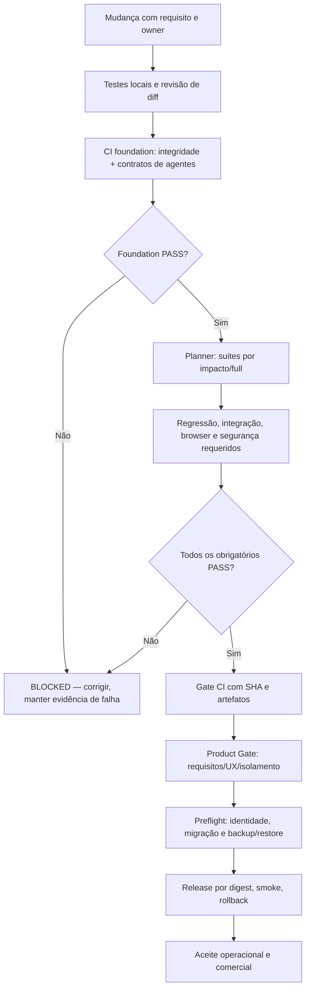

[← Ficha do capítulo](../) · [Volume](../../) · [Fonte original](https://github.com/delmacy/syndes-system/blob/main/docs/subprojects/Q10-quality-gates/chapters/05-arquitetura-banco-interface-configuracao-e-diagramas.md)

> Conteúdo espelhado da documentação versionada; não expressa automaticamente estado funcional.

## 5. Fluxo dos gates, dados e diagrama de qualidade

### Cadeia de evidência (modelo processual, não estado do deploy)

**Fonte real do pipeline:** [syndes-ci.yml](https://github.com/delmacy/syndes-system/blob/main/.github/workflows/syndes-ci.yml). O grafo inclui gates **manuais/externos**; não afirmar que todos são jobs automatizados.

### Matriz de fases e proprietários

| Nível | Owner/evidência | Pode aprovar? |
|---|---|---|
| **Repo Gate** | Q10: `tests/integrity/repository-structure.sh`; Q07: `foundation` | Só conformidade estrutural quando executado e aprovado |
| **Build e unit** | Q02 + módulo; Node/Go, lockfile, testes unitários e pack | Só incremento testado no SHA |
| **Integração/contrato** | Q03 + módulos; API/PG/migrations/events/idempotência | Só integração no ambiente do ensaio |
| **Segurança e E2E** | Q04/Q05; identidade real, tenants A/B, perfis/rotas e UI | Só cenário/ambiente testado |
| **Release Candidate** | Q06/Q08/Q09; imagem imutável, infraestrutura, restore, perf/soak | Só RC quando todos os gates relacionados forem aprovados |
| **Operação/Produto** | Produtor de release, segurança, operador e responsável do produto | Homologação somente por aceite explícito |

### Matriz de bloqueio de risco

| Caso | Bloqueio inegociável |
|---|---|
| Consulta de tenant errado | Falhar 403/404 sem revelar conteúdo, sem tratar claims do browser como owner |
| Erro OpenFGA/Keycloak | Sem fallback permissivo, operação negada e auditoria sanitizada |
| Migração | Sem backup/restore/rollback e aprovação por owner, **não aplicar em ambiente real** |
| Event Outbox/worker | Teste de lease, transaction, idempotência e ENABLED; PG17 sintético não autoriza worker ativo |
| CI faltante/falho | Não considerar `DONE`, ainda que Docs Pages tenha publicado |
| Instalação/release | Sem digest, perfis, consentimento e smoke reais, não declarar go-live |

### Modelo de armazenamento/UX

- Q10 **não mantém banco PostgreSQL, migrations, tabelas ou API REST**. Fonte: scripts, resultados de CI, WBS e documentos versionados.
- Results e evidências do GitHub Actions pertencem ao run/job/SHA; arquivos STATUS e páginas podem **apontar** para eles, mas não devem substituir a fonte.
- A UI do Syndes Docs apresenta gates e documentos, não concede permissão nem atualiza estado operacional do CI automaticamente.
- `tests/integrity/AGENTS.md` e `AGENTS.md` são contratos de execução de testes, não configurações de tenant/segredos.

### Verificações de performance

A [estratégia de testes](https://github.com/delmacy/syndes-system/blob/main/docs/engineering/TEST-STRATEGY.md) planeja degraus **50, 200, 500, 1000, 2500 tenants**, spike e soak inicial de **no mínimo 2 horas** no RC, sob recursos controlados e providers apropriados. **Nenhuma dessas metas é evidência de capacidade suportada**; medir antes de certificar.

---
**Rastreabilidade:** [revisar documento fonte](https://github.com/delmacy/syndes-system/blob/main/docs/subprojects/Q10-quality-gates/chapters/05-arquitetura-banco-interface-configuracao-e-diagramas.md).
